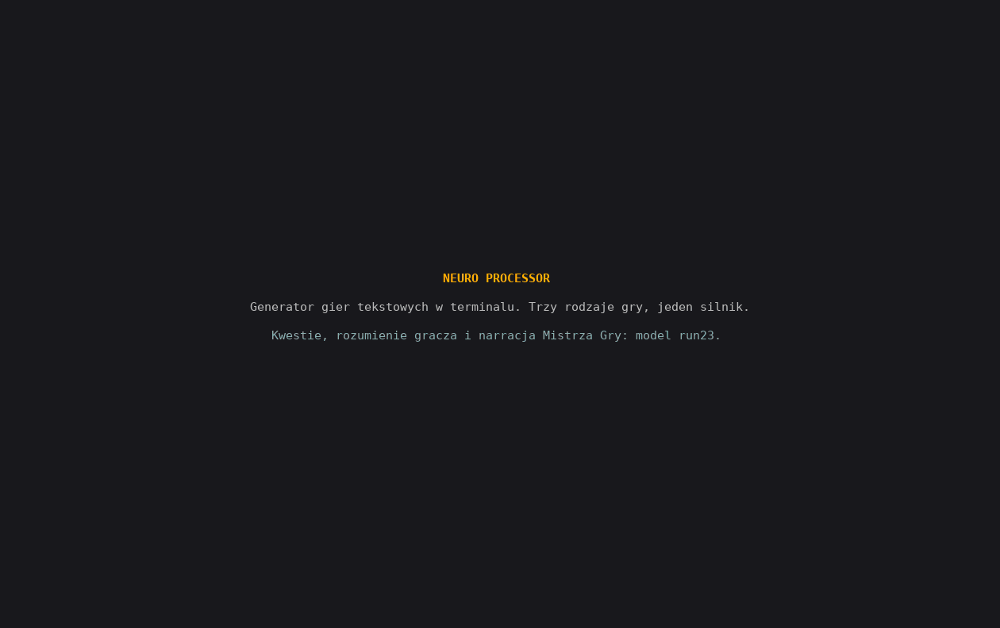
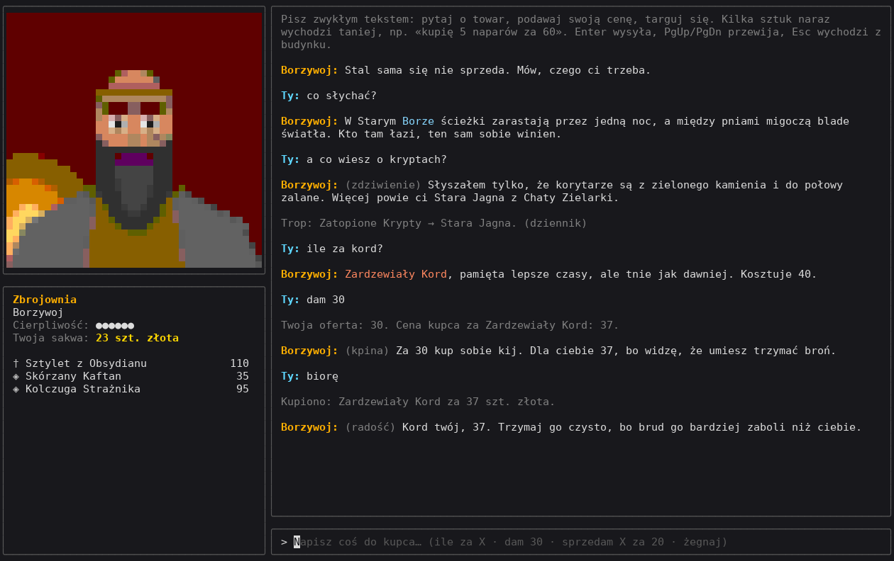
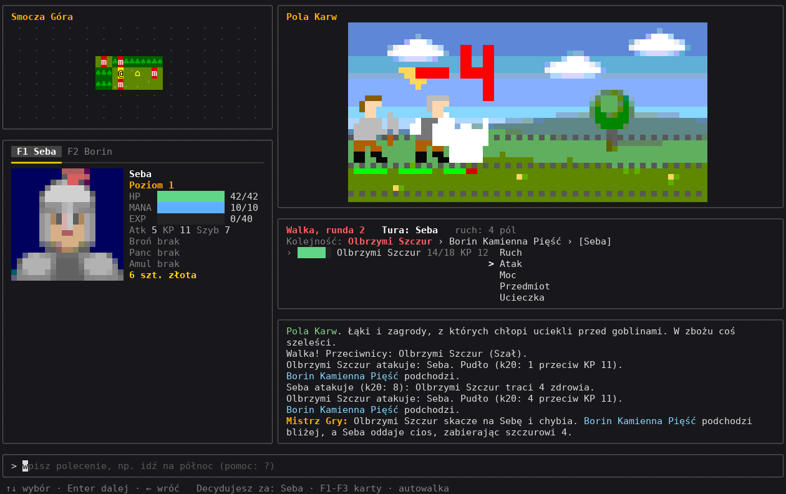
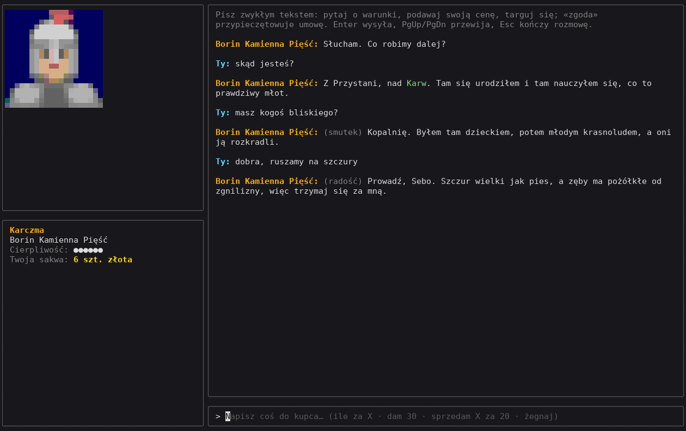
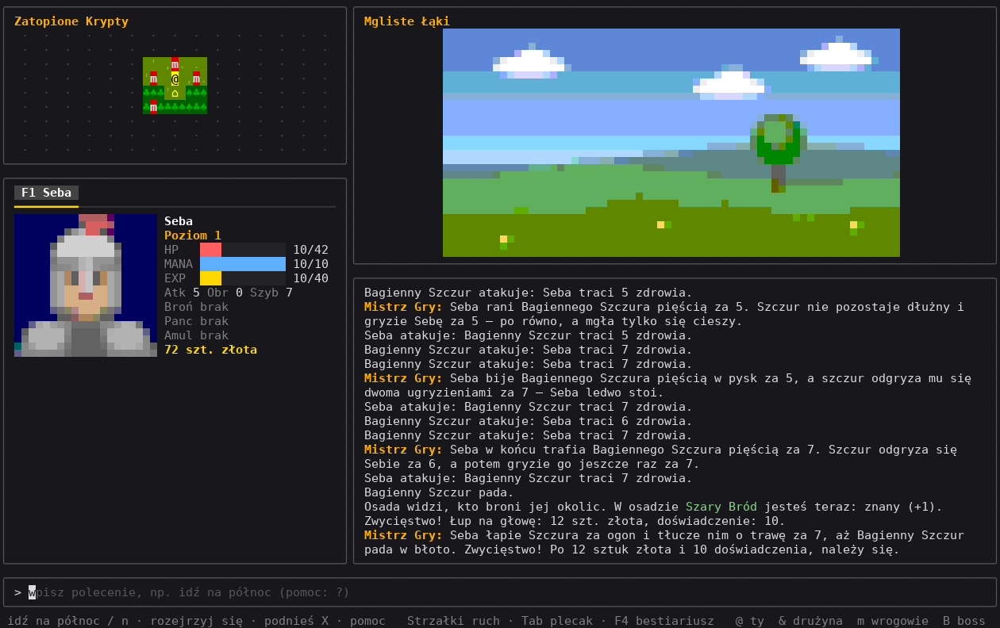
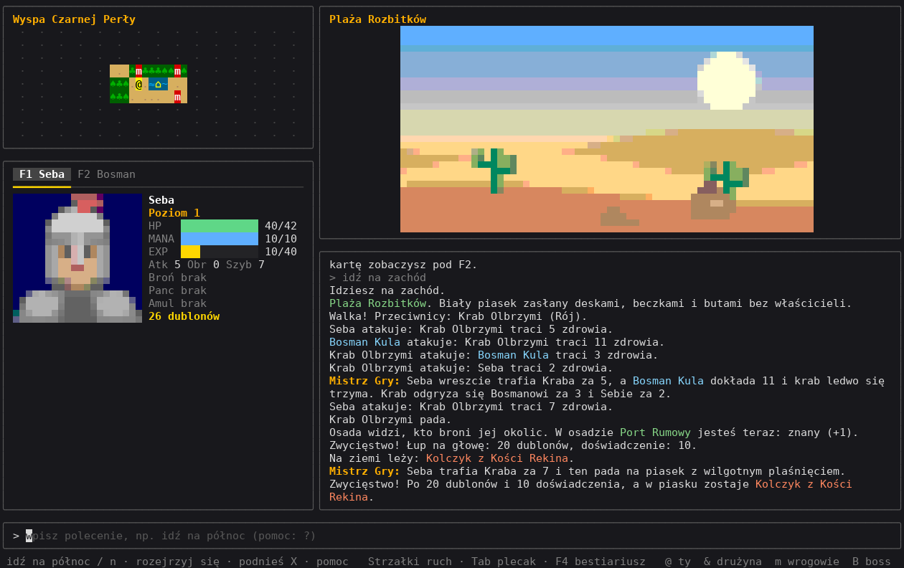
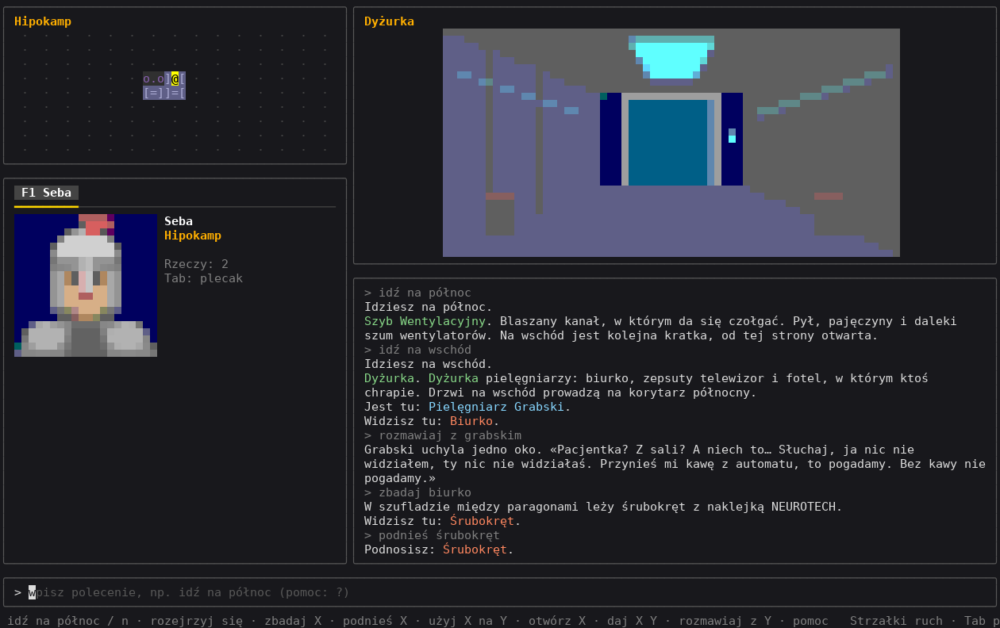
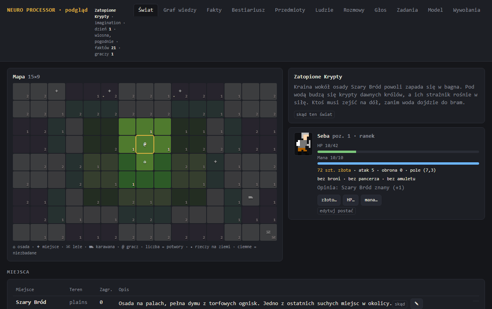

Neuro Processor
===============

**English** · *[Polski](README.pl.md)*

[](https://github.com/sebastianrozmus/neuro-processor/actions/workflows/go.yml)
[](LICENSE)



A text RPG for the terminal that makes up its own worlds. Describe a world in a few words and a language model invents the places, monsters, items and people. The code builds the map, stats, prices and rules, so every world is playable at once. Inspired by the Polish classic *Mózgoprocesor*. Written in Go; the game itself speaks **Polish**.

The core idea: **rules decide, the model only narrates.** You haggle with shopkeepers in free text, bargain with mercenaries over pay, a game master describes each fight, and rumours travel between settlements. Every outcome (a price, a hit, who knows what) comes from the rules, and every line the model writes is checked for amounts, names and facts before you see it.

Everything runs locally with [Ollama](https://ollama.com). The characters are voiced by Bielik 11B, fine-tuned for this game.

Highlights
----------

- **World generator**: four kinds of game from a one-line prompt; code validates and repairs the model's design, then saves the world.
- **Free-text conversations**: haggle, sell, ask about the world. Each line carries a mood tag (`[kpina] Tyle za rurę?`, *"[mockery] That much for a pipe?"*) that you can hear in the voice.
- **A living world**: a knowledge graph of who knows what, rumours, leads, events, weather and seasons, a travelling caravan, reputation, quests made from rumours.
- **Characters who remember**: a companion who once mentioned a brother still has him in the next conversation.
- **Browser inspector** (`NEURO_DEBUG=on`): map, knowledge graph, bestiary, live editing and the origin of every entry.
- **Multiplayer over SSH**: friends join with a plain `ssh` client.
- **Voice and microphone** (optional): Piper, Chatterbox with cloned voices, or the system voice; talk to the game through Whisper.
- **Pixel art in the terminal**: scenes, monsters and portraits in block characters; worlds and avatars painted locally by SD-Turbo.

| | |
|---|---|
| <br>Haggling with an armourer (model run23) | <br>D&D fight with game-master commentary (run23) |
| <br>Talking to Borin (run25, candidate not adopted) | <br>Game master narrating a fight (run25, candidate not adopted) |
| <br>Generated world (run21) | <br>Adventure mode (texts from the world file) |
| <br>Browser inspector | |

The animation at the top and the screenshots come from real models (`go run ./tools/demo -live`). Each caption names the run that wrote the text.

Game modes
----------

| Mode | What it is | Built-in worlds |
|---|---|---|
| **Imagination** | map, settlements, shops, party, simple combat, a narrator | Zatopione Krypty, Popiół i Rdza, Stacja Erebus |
| **D&D** | the same with tabletop rules: d20, armour class, weapon dice, grid combat | Smocza Góra |
| **Adventure** | rooms, items, puzzles, no combat; add a deadline and it's an escape room | Hipokamp, Pracownia Zegarmistrza |
| **Investigation** | a town with a hidden truth, people with daily schedules, an accusation backed by evidence | Jeziorna, Kanał 7 |

Quick start
-----------

**1. The game.** Download a build from [Releases](https://github.com/sebastianrozmus/neuro-processor/releases) and run `neuro`, or build from source with Go 1.22+:

```sh
go run ./cmd/neuro
```

You need a terminal of at least 118×36 with 256 colours. On macOS, unblock a browser download with `xattr -d com.apple.quarantine neuro`. Without a model the game still runs: built-in worlds, combat, saving and multiplayer all work; shopkeepers use canned lines.

**2. The model (recommended).** Install Ollama, then:

```sh
ollama pull hf.co/rozmus/neuro-npc-bielik-11b-v3-GGUF:Q5_K_M
```

and create `.env.local` in the folder you run the game from, or in the game's data folder (`~/Library/Application Support/neuro-processor` on macOS, `~/.config/neuro-processor` on Linux, `%AppData%\neuro-processor` on Windows). One model plays every role:

```
NEURO_LLM_BASE_URL=http://localhost:11434/v1
NEURO_LLM_MODEL=hf.co/rozmus/neuro-npc-bielik-11b-v3-GGUF:Q5_K_M
NEURO_TALK_BASE_URL=http://localhost:11434/v1
NEURO_TALK_MODEL=hf.co/rozmus/neuro-npc-bielik-11b-v3-GGUF:Q5_K_M
NEURO_WORLD_MODEL=hf.co/rozmus/neuro-npc-bielik-11b-v3-GGUF:Q5_K_M
```

It needs about 8.7 GB of GPU memory (8192-token context); on an RTX 4060 Ti a line takes about 2 s. With less memory, use a small general model such as `gemma3:4b` in `NEURO_LLM_MODEL` alone and drop the `NEURO_TALK_` lines. Any OpenAI-compatible API works too.

**3. Play.** Commands are Polish; case and diacritics don't matter: `idź na północ` (go north, or `n`), `rozejrzyj się` (look around), `podnieś miecz` (pick up the sword), `idź do zbrojowni` (enter the armoury), `atakuj` (attack), `dziennik` (journal), `pomoc` (help). In a shop, just talk: `ile za kord?`, `dam 30`, `sprzedam kord za 40`.

**Multiplayer:** `neuro -listen :2222`, then others run `ssh -p 2222 NAME@HOST`. There is no authentication, so open the port only on a trusted network.

How it works
------------

The model never decides an outcome and never computes anything.

- **Worlds.** The model returns a design that must match a JSON schema. `internal/world` validates and repairs it, then derives the map, monster stats, item effects and prices. A rejected design goes back once, with the reason.
- **A conversation turn.** (1) Plain rules read the player's line: amounts, items, clear phrases. The model is asked only when it's ambiguous. (2) The rules compute the result: sale, counter-offer, insult, lost patience. (3) The talking model voices that decision in character.
- **Checks.** A line with an amount the rules didn't produce or a mangled name is refused; the model gets one retry, then a fallback line is used.
- **One realm, many screens.** All state lives in one object (`game.Realm`); single- and multiplayer are the same code.

More in [docs/SILNIK.md](docs/SILNIK.md) (Polish).

The model
---------

`neuro-npc` is Bielik 11B v3.0 ([SpeakLeash](https://huggingface.co/speakleash)) fine-tuned for this game: [rozmus/neuro-npc-bielik-11b-v3-GGUF](https://huggingface.co/rozmus/neuro-npc-bielik-11b-v3-GGUF). One model does everything the game asks of a language model: in-character lines with a mood tag, the game master's narration of each combat round, and small JSON "mind" tasks (reading what the player means, noting facts, remembering what a character said about itself).

It was trained in two stages on one RTX 4060 Ti 16 GB: QLoRA SFT on about 9,000 examples in the game's exact prompt formats (a fifth of them in other games' NPC conventions), then DPO on about 670 preference pairs. Every version is checked against the previous one by blind judges on test sets it never saw, under a decision rule written before the evaluation. Against the previous release it makes significantly fewer heavy errors in conversations (148 → 92 on 420 items), in prompts from other games and mods, and on an independent test set, with nothing significantly worse; general abilities (EQ-Bench PL, MT-Bench PL) stay at the base model's level.

The data pipeline, training scripts, evaluation and the full history of every run (including what was rejected and why) are in `tools/`: [tools/model/MODELE.md](tools/model/MODELE.md) and [tools/model/HISTORIA.md](tools/model/HISTORIA.md) (Polish); see also [docs/SILNIK.md](docs/SILNIK.md#model-neuro-npc).

Documentation (Polish)
----------------------

- [How to play](docs/GRA.md): commands, combat, party, the living world, D&D, adventures and investigations, multiplayer.
- [Settings](docs/USTAWIENIA.md): models, `NEURO_*` variables, voice, images, the inspector.
- [How it works](docs/SILNIK.md): engine, checks, the model and how to train it.
- [Releases](docs/WYDANIA.md).

Development
-----------

```sh
go test ./...
go vet ./...
```

The first version, written in PHP and Symfony, lives on the `php-legacy` branch.

Credits and license
-------------------

MIT, see [LICENSE](LICENSE). Built with [Bubble Tea](https://github.com/charmbracelet/bubbletea), [Lip Gloss](https://github.com/charmbracelet/lipgloss) and [Wish](https://github.com/charmbracelet/wish). Models are downloaded separately under their own licenses: [Bielik](https://huggingface.co/speakleash), [Gemma 3](https://ai.google.dev/gemma), [SD-Turbo](https://huggingface.co/stabilityai/sd-turbo), [Whisper](https://huggingface.co/mlx-community/whisper-large-v3-turbo), [Chatterbox](https://github.com/resemble-ai/chatterbox), [Piper](https://github.com/rhasspy/piper) with Polish voices from [piper-voices](https://huggingface.co/rhasspy/piper-voices) (CC0). `tools/data` converts the [FIREBALL](https://huggingface.co/datasets/lara-martin/FIREBALL) dataset (CC-BY-4.0).
