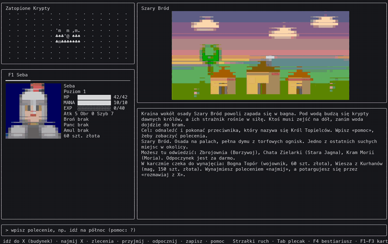
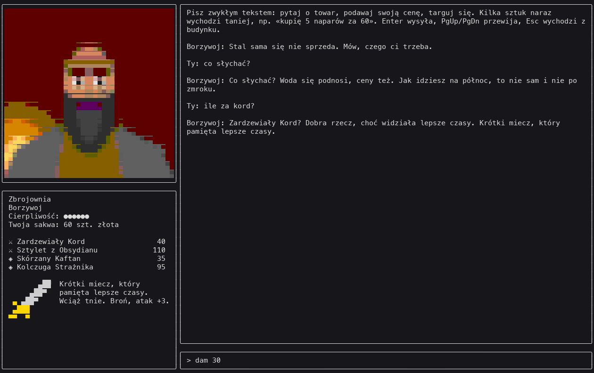
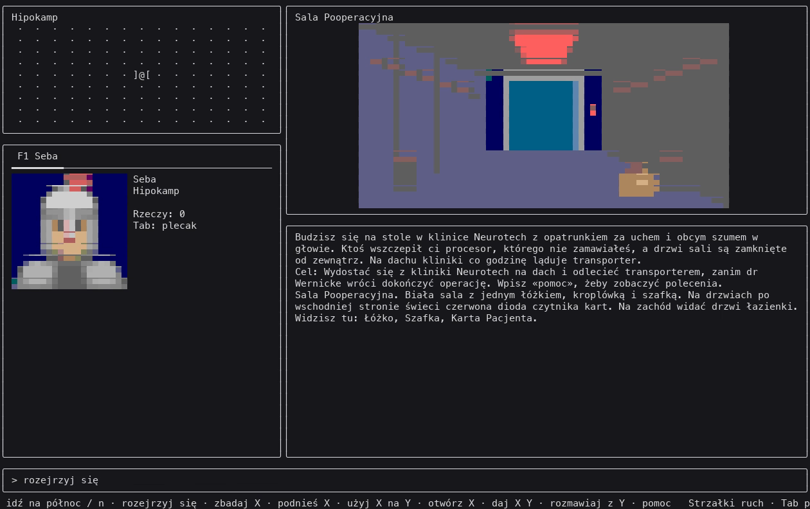
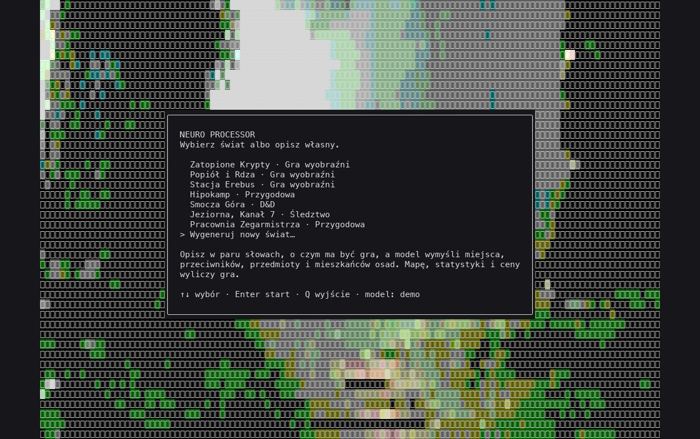
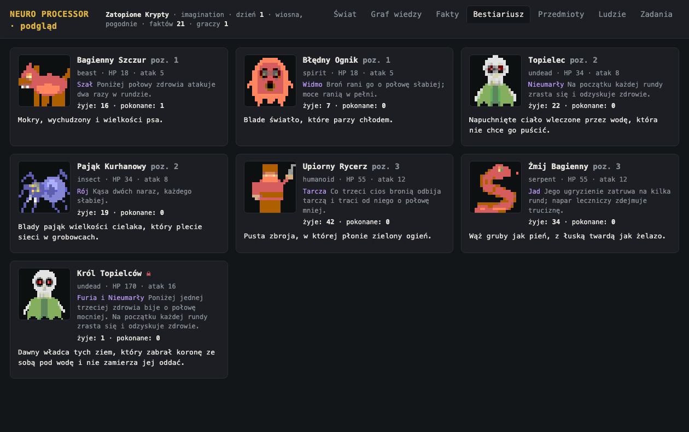

Neuro Processor
===============

**English** · *[Polski](README.pl.md)*

[](https://github.com/sebastianrozmus/neuro-processor/actions/workflows/go.yml)
[](LICENSE)



A text RPG for the terminal that generates its own worlds. Describe a world in a few words and a language model invents the places, monsters, items and people; the code builds the map, stats, prices and every rule, so each world is playable at once. Inspired by the Polish classic *Mózgoprocesor*. Written in Go; the game itself speaks **Polish**.

The core idea: **rules decide, the model only narrates.** Shopkeepers haggle in free text, mercenaries bargain over their pay, a game master describes each fight, and characters pass rumours along a knowledge graph. But every outcome — a price, a hit, who knows what — comes from the game's rules, and every line the model writes is checked (amounts, names, facts) before the player sees it.

Everything runs locally with [Ollama](https://ollama.com): a small model reads intents, and a Polish model fine-tuned for this game does the talking. The training data pipeline, the training scripts (Mac and NVIDIA PC) and the evaluation bench are all in this repository.

Highlights
----------

- **World generator** — four kinds of game from a one-line prompt; generated worlds are validated and repaired by code, and saved.
- **Free-text conversations** — haggle, sell, ask about the world; the rules compute the deal, the model voices it in character, with a mood tag (`[kpina] Tyle za rurę?` — *"[mockery] That much for a pipe?"*) used for voice and colour.
- **Living world** — a knowledge graph of who knows what, rumours spreading between settlements, leads that point you to the person who knows more, events, weather, seasons, a travelling caravan, reputation, quests made from rumours.
- **Guardrails on every line** — numbers must come from the game, names must be spelled as given, facts noted from conversations must be quoted from them; a refused line gets one retry, then a safe fallback.
- **Browser inspector** (`NEURO_DEBUG=on`) — the running world as a map, knowledge graph, bestiary, items and people; edit anything live, see where every entry came from (prompt, original, rejected attempts and why), and mark bad lines for the next round of training.
- **Multiplayer over SSH** — host a world, friends join with a plain `ssh` client.
- **Optional voice and microphone** — system TTS or [Chatterbox](https://github.com/resemble-ai/chatterbox) with cloned voices and audible moods; push-to-talk with local Whisper.
- **Pixel art in the terminal** — scenes, sprites and portraits drawn with block characters; generated worlds and custom avatars painted locally by SD-Turbo.

| Screenshot | |
|---|---|
|  |  |
|  |  |

Game modes
----------

| Mode | What it is | Built-in worlds |
|---|---|---|
| **Imagination** | map, settlements, shops, party, simple-number combat, a narrator and drawn scenes | Zatopione Krypty, Popiół i Rdza, Stacja Erebus |
| **D&D** | same kind of world with tabletop rules: d20 vs armour class, weapon dice, criticals, saving throws, initiative, a grid battlefield with movement and opportunity attacks | Smocza Góra |
| **Adventure** | a classic text adventure: rooms, items, puzzles, people to talk to and a goal; no combat; with a deadline it becomes an escape room | Hipokamp, Pracownia Zegarmistrza |
| **Investigation** | a town with a hidden truth: people know pieces and keep daily schedules, things hide clues, the case ends with an accusation backed by evidence | Jeziorna, Kanał 7 |

Quick start
-----------

**1. The game.** Download a build for macOS, Linux or Windows from [Releases](https://github.com/sebastianrozmus/neuro-processor/releases) and run `neuro`, or build from source with Go 1.22+:

```sh
go run ./cmd/neuro
```

On macOS, a binary downloaded with a browser is blocked until you run `xattr -d com.apple.quarantine neuro`. You need a terminal of at least 118×36 with 256 colours. Without a model the game runs offline: built-in worlds, commands, combat, saving and multiplayer all work; shopkeepers answer with canned lines.

**2. The models (recommended).** Install Ollama, then:

```sh
ollama pull gemma3:4b
ollama pull hf.co/sebastianrozmus/neuro-npc-bielik-11b-GGUF:Q5_K_M
```

and put this in `.env.local` — in the folder you run the game from, or in the game's data folder (`~/Library/Application Support/neuro-processor` on macOS, `~/.config/neuro-processor` on Linux, `%AppData%\neuro-processor` on Windows):

```
NEURO_LLM_BASE_URL=http://localhost:11434/v1
NEURO_LLM_MODEL=gemma3:4b
NEURO_TALK_BASE_URL=http://localhost:11434/v1
NEURO_TALK_MODEL=hf.co/sebastianrozmus/neuro-npc-bielik-11b-GGUF:Q5_K_M
```

Gemma reads intents, notes facts, invents items and generates worlds; the fine-tuned model speaks for the characters. Both together need about 14 GB of memory. With less, use gemma alone (drop the two `NEURO_TALK_` lines). Any OpenAI-compatible API works too (`NEURO_LLM_BASE_URL`, `NEURO_LLM_API_KEY`), and a large cloud model generates noticeably richer worlds.

**3. Play.** Commands are typed in Polish, case and diacritics don't matter: `idź na północ` (go north, or just `n`), `rozejrzyj się` (look around), `podnieś miecz` (pick up the sword), `idź do zbrojowni` (enter the armoury), `atakuj` (attack), `najmij Bognę` (hire Bogna), `dziennik` (journal), `pomoc` (help). In a shop just talk: `ile za kord?`, `dam 30`, `sprzedam kord za 40`. The full command list is in the [Polish README](README.pl.md#polecenia).

**Multiplayer:** `neuro -listen :2222`, then others join with `ssh -p 2222 NAME@HOST`. There is no authentication; open the port only on a trusted network.

How it works
------------

The model never decides an outcome and never computes anything.

- **World generation.** The model returns a world description that must match a JSON schema (names, descriptions, terrain and monster shapes from closed lists, difficulty 1–3). `internal/world` validates and repairs it, then derives the map, monster stats, item effects and prices. A rejected design goes back to the model once, with the reason. Before that, a separate *style card* captures the inspiration in the player's prompt ("a detective game in the style of Cowboy Bebop") and flows into every later prompt.
- **A conversation turn** has three steps. (1) Plain rules read the player's line: amounts, quantities, item names, clear phrases; the model is asked only when a number might or might not be an offer, or to weigh a long argument. (2) The rules compute the result: sale, counter-offer, insult, lost patience. The minimum price never reaches the model. (3) The talking model writes the character's line for that decision, from the character's persona and knowledge and a `[GRA]` block describing what happened.
- **Checks.** A line with an amount the rules didn't produce, a spelled-out number, a mangled name, or a missing name the player was promised is refused with a reason; the model gets one retry, then a fallback line is used. Refusals are visible in the inspector.
- **Knowledge.** The game keeps a graph of facts and who knows them. Characters share what they know, admit what they don't and send you to whoever knows ("I only heard the barrows glow at night — ask the travelling merchant, his caravan is in Stary Bór today"). New facts from conversations enter the graph only if the reading model can quote them from the line.
- **One realm, many screens.** All state lives in one object (`game.Realm`); every player, local or over SSH, has only their own screen, so single- and multiplayer are the same code.

The model
---------

`neuro-npc` is Bielik 11B v2.3 ([SpeakLeash](https://huggingface.co/speakleash)) fine-tuned with QLoRA on ~3,400 conversations in the game's exact prompt format. It is published on Hugging Face: [sebastianrozmus/neuro-npc-bielik-11b-GGUF](https://huggingface.co/sebastianrozmus/neuro-npc-bielik-11b-GGUF).

On an 80-case regression bench (cases never seen in training, checked for format, amounts and mood tag):

| model | seed 42 | seed 7 |
|---|---|---|
| Bielik 11B, untrained | 8/80 | 6/80 |
| run 6 — Bielik 4.5B, LoRA on a Mac | 76/80 | 78/80 |
| **run 7 — Bielik 11B, QLoRA on an RTX 4060 Ti** | **80/80** | **80/80** |

Everything needed to reproduce or improve it:

| path | what it does |
|---|---|
| `tools/model/` | data preparation, LoRA training on Apple Silicon (MLX), GGUF export to Ollama, the data specification used to order training data (`PROMPT.md`) and the full history of all runs — what worked and what was rejected (`HISTORIA.md`, Polish; also as a page in `docs/`) |
| `tools/pc/` | QLoRA training on a Windows PC with an NVIDIA card (WSL2 + Unsloth) |
| `tools/bench/` | the regression bench, replays of real game conversations on several models, and a validator for new training data |
| `tools/hf/` | the model card and the upload script for Hugging Face |
| `tools/synth/` | self-play: the game plays shop scenarios against itself to produce training conversations |

Configuration
-------------

Settings come from environment variables or `.env.local`. The most useful ones:

| variable | meaning |
|---|---|
| `NEURO_LLM_MODEL`, `NEURO_LLM_BASE_URL`, `NEURO_LLM_API_KEY` | the main model; empty model = offline mode |
| `NEURO_TALK_MODEL`, `NEURO_TALK_BASE_URL` | a second model just for character lines |
| `NEURO_DEBUG` | `on` starts the browser inspector at `http://127.0.0.1:7788/` |
| `NEURO_TTS` | `1` reads lines aloud with the system voice; `chatterbox` uses Chatterbox (set up with `tools/speech/setup-tts.sh`) |
| `NEURO_LOG_TALKS` | `1` logs every conversation with its full prompt to `talks.jsonl`, for training and replays |
| `NEURO_IMAGES` | `auto` shows painted scenes as real images in terminals with the kitty graphics protocol |

The full list is in the [Polish README](README.pl.md#model-językowy). Custom avatars and painted worlds need `tools/avatar/setup.sh` (a Python environment with SD-Turbo, ~2.5 GB).

Development
-----------

```sh
go test ./...
go vet ./...
```

`go run ./tools/demo -out frames && python3 tools/demo/render.py frames demo.mp4` records a demo without a terminal or a model. Releases are built by GoReleaser when a `v*` tag is pushed (`.goreleaser.yaml`, `.github/workflows/release.yml`; the process in Polish: `docs/WYDANIA.md`).

The first version of the project, written in PHP and Symfony, is kept on the `php-legacy` branch.

Credits and license
-------------------

MIT, see [LICENSE](LICENSE). Built with [Bubble Tea](https://github.com/charmbracelet/bubbletea), [Lip Gloss](https://github.com/charmbracelet/lipgloss) and [Wish](https://github.com/charmbracelet/wish). Models used at runtime are downloaded separately under their own licenses: [Bielik](https://huggingface.co/speakleash) (the base of `neuro-npc`), [Gemma 3](https://ai.google.dev/gemma), [SD-Turbo](https://huggingface.co/stabilityai/sd-turbo), [Whisper](https://huggingface.co/mlx-community/whisper-large-v3-turbo), [Chatterbox](https://github.com/resemble-ai/chatterbox). `tools/data` converts the [FIREBALL](https://huggingface.co/datasets/lara-martin/FIREBALL) dataset (CC-BY-4.0).
