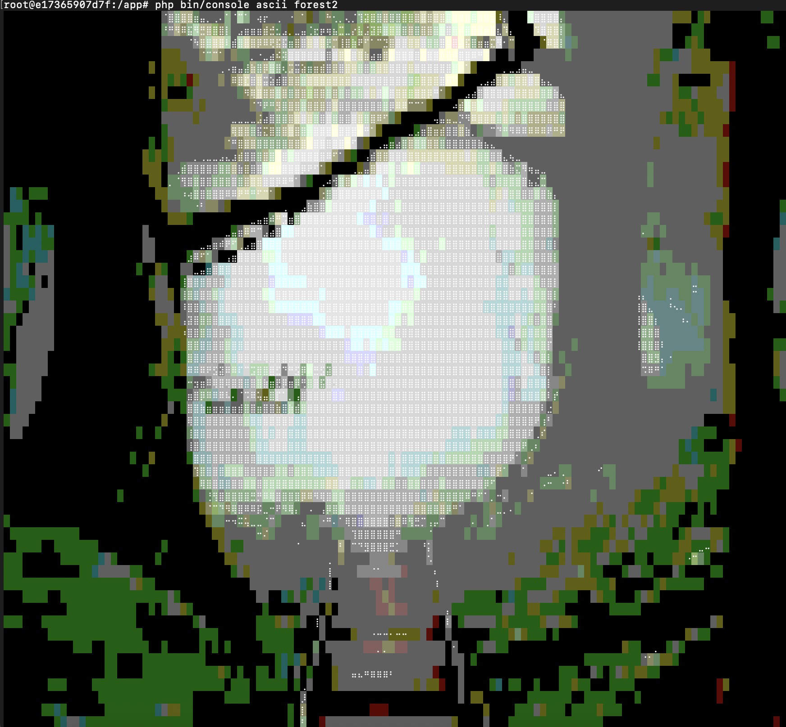
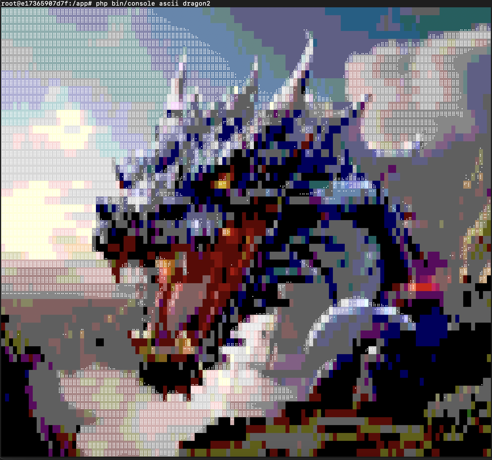
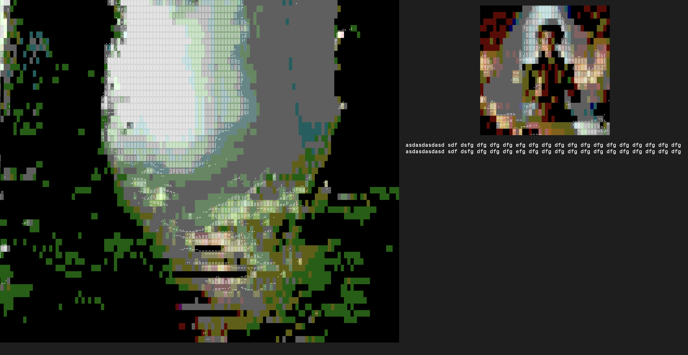

Neuro Processor
===============

Neuro Processor to gra konsolowa inspirowana klasykiem, jakim jest Mózgoprocesor. To moja osobista zabawa w tworzenie czegoś, co łączy retro klimat z nowoczesnymi możliwościami grafiki w terminalu i programowania. Gra jest napisana w Go.

O Grze
======

Neuro Processor jest generatorem gier: opisujesz w paru słowach, o czym ma być świat, a model językowy wymyśla miejsca, przeciwników, przedmioty i mieszkańców osad. Mapę, statystyki, ceny i wszystkie zasady wylicza kod, więc każdy wygenerowany świat jest od razu grywalny. Gotowe światy są też wbudowane.

Gra się jak w Mózgoprocesorze: na ekranie widać rysunek miejsca, w którym stoisz, a polecenia wpisuje się tekstem.

Przy tworzeniu świata wybiera się rodzaj gry:

| Rodzaj | Co to znaczy | Wbudowane przykłady |
|---|---|---|
| **Gra wyobraźni** | mapa, osady, kupcy, drużyna, walka rozstrzygana prostymi liczbami, narrator i rysowane sceny | Zatopione Krypty, Popiół i Rdza, Stacja Erebus |
| **D&D** | ten sam rodzaj świata, ale zasady stołowego RPG: rzut k20 przeciw klasie pancerza (KP), kości broni, trafienia krytyczne, rzuty obronne, inicjatywa i walka na siatce z ruchem, zasięgiem i atakami okazyjnymi | Smocza Góra |
| **Przygodowa** | tekstowa przygodówka jak Mózgoprocesor: pomieszczenia, przedmioty, zagadki, ludzie do pogadania i cel do osiągnięcia; bez walki i statystyk; z terminem robi się z niej escape room | Hipokamp, Pracownia Zegarmistrza |
| **Śledztwo** | miasteczko z ukrytą prawdą: ludzie wiedzą po kawałku i mają plan dnia, rzeczy kryją poszlaki, a sprawę kończy oskarżenie poparte dowodami; rozmowy z mieszkańcami prowadzi model, ale tylko z tego, co dana osoba wie | Jeziorna, Kanał 7 |

Generator umie tworzyć każdy z tych rodzajów (przygodówkę opisuje innym schematem: pokoje, rzeczy, osoby i kroki zagadek).

Główne Funkcje
==============

*Generator światów*: Nowy świat z opisu gracza. Wygenerowane światy zapisują się na dysku i wracają w menu.

*Wbudowane światy*: Zatopione Krypty (fantasy), Popiół i Rdza (postapokalipsa), Stacja Erebus (science fiction).

*Polecenia tekstowe*: `idź na wschód`, `podnieś miecz`, `rzuć iskrę na topielca`, `idź do zbrojowni`. Odmiana i polskie znaki nie mają znaczenia.

*Widok miejsca*: Każde pole ma swój rysunek, zależny od terenu. Widać na nim osadę, miejsce szczególne, leżące przedmioty i przeciwników, z którymi walczysz.

*Mapa*: 15x9 pól, odkrywana w miarę wędrówki. Im dalej od pierwszej osady, tym groźniej; w jednym z rogów czeka główny przeciwnik.

*Osady i miejsca*: W każdym świecie są osady z budynkami (zbrojownia, zielarz lub medyk, sklep z mocami) oraz miejsca szczególne: strzeżone skrytki i miejsca, które przywracają siły. Dalsze osady sprzedają lepszy sprzęt.

*Walka*: Turowa, z grupami przeciwników, sterowana z menu: wybierasz cel, potem zwykły atak, moc, przedmiot albo ucieczkę. Z pokonanych zostają pieniądze i przedmioty na ziemi.

*Magia*: Moce, których bohater uczy się z przedmiotów i rzuca w walce, oraz noszone przedmioty magiczne. Poznane moce zostają na stałe i można ich znać dowolnie wiele.

*Doświadczenie i poziomy*: Za pokonanych przeciwników bohater dostaje doświadczenie. Każdy poziom (do dziesiątego) dodaje zdrowia, mocy i ataku oraz przywraca siły.

*Targowanie*: Z gospodarzami budynków rozmawia się zwykłym tekstem i negocjuje ceny. Gdy gospodarz w rozmowie zaproponuje coś, czego w świecie nie ma, przedmiot „wpada do świata”: pojawia się w jego sklepie z ceną i działaniem wyliczonym z opisu i można go kupić.

*Mistrz Gry*: Gdy skonfigurowany jest model, po każdej rundzie walki Mistrz Gry opisuje w dzienniku, co się stało. Opis przychodzi w tle i nie zatrzymuje walki; zasady rozstrzygają wszystko same, a Mistrz Gry dostaje tylko ich wynik do opowiedzenia.

*Mowa*: Opcjonalnie kwestie gospodarzy i Mistrza Gry są czytane na głos, a model dobiera do każdej nastrój (kpina, gniew, radość…), który słychać w głosie i widać przy kwestii. Opcjonalnie też mówisz do gry: F5 włącza mikrofon, F5 kończy, a rozpoznany tekst trafia do wiersza poleceń albo do rozmowy. Można kupować po kilka sztuk naraz, np. `kupię 5 naparów za 60`: kwota dotyczy całości, a hurtem jest taniej (do 15% na sztuce).

*Postać*: Przed wejściem do świata wybierasz imię i awatar: jeden z sześciu wbudowanych albo własny, narysowany przez mały lokalny model obrazkowy z twojego opisu i zapisany pod wybraną nazwą.

*Zapis gry*: Polecenie `zapisz` zapisuje stan świata; zapisane gry pojawiają się w menu.

*Towarzysze*: W karczmie każdej osady czekają bohaterowie do wynajęcia: wojownik, uzdrowiciel albo mag. `najmij X` bierze ich do drużyny (najwyżej dwoje), `odpraw X` odsyła. `rozmawiaj z bogną` przysiada się do najemnika w karczmie: gadasz z nim jak z kupcem, tyle że jedynym towarem jest jego służba — cenę (a u legendy dzienny żołd) targujesz jak każdą inną, do 70 % (żołd do 80 %), a «zgoda» przypieczętowuje umowę. Z towarzyszem, który już z tobą chodzi, rozmawiasz tak samo, za darmo. Towarzysz jest pełną postacią: ma poziom i doświadczenie, zdrowie, moc, broń, pancerz, amulet, moce i awatar. Rzeczy dajesz mu poleceniem `daj kord bognie`, odbierasz `odbierz kord od bogny`. Lewy panel pokazuje drużynę jako zakładki z klawiszami: F1 to twoja postać, F2 i F3 towarzysze (albo `pokaż bognę`); pod zakładkami jest karta wybranej osoby, a Tab otwiera jej plecak i moce. Każda rzecz ma ikonę piksel-art według rodzaju i nazwy (miecz, topór, łuk, pancerz, tarcza, flaszka, zwój, księga, amulet, pierścień…) w kolorze efektu: w plecaku przy wybranej rzeczy, u kupca przy towarze, o którym mowa.

*Karta postaci*: Tab otwiera kartę wybranej postaci (F1 ty, F2 i F3 towarzysze): sześć cech jak w D&D (Siła, Zręczność, Kondycja, Inteligencja, Mądrość, Charyzma) z modyfikatorami, liczby bojowe, sprzęt, plecak i moce. Cechy działają na zasady: Siła dodaje do ataku, Zręczność do szybkości i ucieczki, Kondycja do zdrowia z każdym poziomem, Inteligencja do mocy, Mądrość wzmacnia leczenie, a Charyzma zjednuje kupców (niższe ceny) i obniża koszt najmu. Twoja postać dostaje cechy według wybranego awatara (wojownik jest silny, czarodziej bystry), a własny awatar oznacza losowanie czterema kośćmi.

*Legenda na żołdzie*: W każdym świecie jest jeden najemnik najwyższej klasy, dwa razy twardszy od reszty i z obiema wrodzonymi mocami. Nie płaci się za niego z góry, tylko żołd o każdym świcie; dzień mija po dwunastu krokach albo po odpoczynku. Odprawiony przestaje pobierać, a gdy zabraknie na żołd, odchodzi sam i oddaje twoje rzeczy.

*Inicjatywa*: Każda postać i każdy potwór ma szybkość. Bohater zyskuje jej z poziomem i traci pod ciężkim pancerzem, towarzysze zależą od roli (mag najszybszy, uzdrowiciel najwolniejszy), potwory od rodzaju (bestie i duchy szybkie, nieumarli i galarety powolne). Kolejność tur w rundzie wynika z szybkości i jest pokazana w panelu walki. Gdy przychodzi tura towarzysza, decydujesz za niego tym samym menu (atak, moc, przedmiot) albo wybierasz „Auto”; `autowalka` oddaje wszystkich towarzyszy automatowi na stałe. Potwory mogą atakować towarzyszy; nieprzytomnych stawia na nogi odpoczynek w osadzie. Gracz, który nie podejmie decyzji w 20 sekund, po prostu atakuje.

*Gra w kilka osób*: Do tego samego świata mogą dołączyć kolejni gracze i wspólnie walczyć.

Uruchomienie
============

Wymagane jest Go 1.22 lub nowsze i terminal o rozmiarze co najmniej 118x36 z obsługą 256 kolorów.

```
go run ./cmd/neuro
```

| Flaga | Znaczenie |
|---|---|
| `-name IMIĘ` | proponowane imię twojej postaci, domyślnie nazwa użytkownika systemu |
| `-listen ADRES` | otwiera świat dla innych graczy, np. `-listen :2222` |

Polecenia
=========

| Polecenie | Co robi |
|---|---|
| `idź na północ` / `południe` / `wschód` / `zachód`, albo `n`, `s`, `e`, `w` | ruch o jedno pole |
| `rozejrzyj się` | opis miejsca, drogi w cztery strony, leżące przedmioty |
| `podnieś X`, `podnieś wszystko` | zabiera przedmioty z ziemi |
| `upuść X` | odkłada przedmiot na ziemię (tak można go komuś przekazać) |
| `użyj X`, `załóż X`, `wypij X`, `naucz się X` | zakłada broń, pancerz lub amulet, wypija miksturę, uczy mocy |
| `atakuj`, `atakuj X` | atak na wybranego albo wskazanego przeciwnika |
| `rzuć X`, `rzuć X na Y` | rzuca poznaną moc |
| `uciekaj` | próba ucieczki z walki na poprzednie pole |
| `odpocznij` | w osadzie przywraca zdrowie i moc |
| `idź do X`, `rozmawiaj z X` | wejście do budynku w osadzie, np. `idź do zbrojowni` |
| `najmij X`, `odpraw X` | wynajęcie towarzysza z karczmy albo odesłanie go |
| `rozmawiaj z X` | rozmowa z najemnikiem w karczmie (targ o cenę lub żołd) albo z własnym towarzyszem |
| `daj X Y`, `odbierz X od Y` | przekazanie rzeczy towarzyszowi (sprzęt zakłada od razu, moce uczy się, mikstury nosi) i zabranie jej |
| `pokaż Y`, `autowalka` | karta towarzysza w lewym panelu (także F1-F3); towarzysze walczą sami |
| `ulecz` | rzuca najsilniejsze leczenie, na jakie masz moc, na całą drużynę (w walce i poza nią) |
| `Imię, ulecz` / `rzuć X na Y` / `atakuj X` / `wypij X` / `automat` | rozkaz dla towarzysza, np. `Lyrasa, ulecz siebie i załogę`; wystarczy pierwsze słowo imienia |
| `powiedz X` | wiadomość do wszystkich graczy |
| `plecak` | karta postaci: cechy, ekwipunek i poznane moce |
| `bestiariusz` | księga potworów (także F4): kogo już spotkałeś, ile ma zdrowia, jak bije i co potrafi |
| `dziennik` | co wiesz i od kogo, oraz twoje zlecenia |
| `zlecenia`, `przyjmij` | zlecenia kupców: lista i przyjęcie tego, które proponuje gospodarz, u którego jesteś |
| `handluj z karawaną` | targ z wędrownym kupcem, gdy jego karawana stoi na twoim polu (`$` na mapie) |
| `czekaj`, `śledź Y`, `oskarżam Y`, `wpisz 1234` | śledztwo i escape room: mija godzina; pójdziesz za osobą, gdy wyjdzie; oskarżenie z dowodami; kod do zamka |
| `zapisz` | zapisuje grę (tylko gospodarz świata) |
| `pomoc`, `wyjdź` | lista poleceń, wyjście z gry |

Skróty: strzałki chodzą po mapie, Tab otwiera plecak (z listą poznanych mocy), F4 bestiariusz, a pusty Enter powtarza ostatnie polecenie.

Rozkazy dla towarzyszy można też wypowiedzieć (F5). Towarzysz wykonuje rozkaz od razu, gdy trwa jego tura albo gdy nie ma walki (leczenie i mikstury), a w walce poza swoją turą zapamiętuje go i wykonuje, gdy kolej przyjdzie na niego. „Ulecz” wybiera najsilniejszą moc leczącą, na którą starcza mocy: wrodzony Opatrunek uzdrowiciela jest darmowy, wyuczone zaklęcie leczy mocniej, ale kosztuje. Poza walką leczenie stawia na nogi także nieprzytomnych.

W budynku rozmawia się z gospodarzem zwykłym tekstem. Oprócz kupowania i targowania się („ile za kord?”, „dam 30”, „kupię 5 naparów za 100”) można też sprzedawać: „sprzedam kord za 40”, „ile dasz za amulet?”, „kupisz ode mnie napar?”. Kupiec skupuje tylko to, czym sam handluje (kowal broń i pancerze, zielarka mikstury, mag zwoje i amulety), daje za rzecz 40% jej ceny i da się go podciągnąć do 55% (więcej przy wysokiej Charyzmie); każde zbyt wysokie żądanie kosztuje jego cierpliwość. Odkupiona rzecz trafia na półkę i można ją kupić z powrotem po pełnej cenie.

Walka ma własne menu, obsługiwane strzałkami, gdy wiersz poleceń jest pusty: góra i dół wybierają pozycję, Enter przechodzi dalej (cel, akcja, a dla mocy i przedmiotów lista do wyboru), strzałka w lewo wraca. Menu zawsze dotyczy postaci, której tura właśnie trwa: twojej albo towarzysza. Po wykonaniu akcji menu zostaje na liście akcji, więc kolejny Enter powtarza atak. Polecenia tekstowe działają w walce tak samo jak poza nią.

Wejście na pole z przeciwnikami zaczyna walkę. Bohater, który padnie, budzi się w ostatnio odwiedzonej osadzie z połową zdrowia i traci część pieniędzy.

Każdy kształt potwora walczy inaczej i warto to znać (bestiariusz pokazuje cechę po pierwszym spotkaniu):

| Kształt | Cecha | Co robi |
|---|---|---|
| bestia | Szał | poniżej połowy zdrowia atakuje dwa razy w rundzie |
| nieumarły | Nieumarły | na początku każdej rundy odzyskuje zdrowie |
| humanoid | Tarcza | co trzeci cios bronią odbija i traci od niego o połowę mniej |
| duch | Widmo | broń rani go o połowę słabiej, moce w pełni |
| wąż | Jad | ugryzienie zatruwa na 3 rundy (3 zdrowia na rundę); napar leczniczy zdejmuje truciznę |
| owad | Rój | kąsa dwóch naraz, każdego słabiej |
| maszyna | Pancerz | każdy cios rani go mniej o grubość pancerza |
| szlam | Kwas | jego cios przeżera zbroję: obrona przed nim nie chroni |

Boss ma cechę swojego kształtu i do tego Furię: poniżej jednej trzeciej zdrowia bije o połowę mocniej. Potwory są wyraźnie twardsze niż bohater pierwszego poziomu, więc w głąb mapy lepiej iść z towarzyszem, miksturami i po kilku poziomach. Ciosy widać w scenie: trafiony przeciwnik błyska i odskakuje, nad nim pojawiają się odebrane punkty, błyskawica mocy uderza w cel, fala podmuchu rozchodzi się po polu, a gdy obrywa twoja drużyna, ekran drga i czerwienieje.

Żywy świat
==========

Świat nie stoi w miejscu:

- **Wiedza i plotki.** Gra prowadzi graf faktów: co jest prawdą o miejscach, potworach, skrytkach i ludziach oraz **kto to wie**. Każdy gospodarz zna swoją działkę (zielarka jady i owady, kowal pancerne bestie, mag duchy), o skrytkach wie jeden czy dwóch, a o tym, czego nie wie, mówi wprost i odsyła do sąsiada: powtarza okruch, który słyszał (pierwsze zdanie faktu, jak plotkę), i wskazuje po imieniu, kto wie resztę i gdzie go szukać; gra pilnuje, żeby imię padło poprawnie, a w dzienniku zostaje **trop** („Trop: Kurhany Królów → Wędrowny Kupiec”), dopóki nie usłyszysz całego faktu. Dopytywanie („a co słyszałeś?”) trzyma się tropu zamiast zmyślać. Plotki rozchodzą się między gospodarzami z dnia na dzień. Gdy gospodarz powie w rozmowie coś nowego i konkretnego (model to wychwytuje tak jak wymyślone przedmioty), fakt trafia do grafu z jego nazwiskiem jako źródłem, zaczyna krążyć, a ty zapisujesz go w **dzienniku** (`dziennik`). Wydarzenia dopisują własne fakty.
- **Wydarzenia.** Każdy świat z mapą ma scenariusz zdarzeń (`events` w presecie): warunek (wejście do miejsca lub skrytki, zabicie n potworów danego rodzaju, nadejście dnia, rozmowa z gospodarzem, posiadanie rzeczy, flagi) i skutki: zmiana miejsca (opis i teren, czyli spalony las na mapie i w scenie), nowe potwory (tu, w całej krainie albo pod osadą), rzeczy, złoto, fakt, zmiana wszystkich cen, flaga, zwycięstwo; zdarzenie może być jednorazowe, losowe (`chance`) i ogłaszane wszystkim. Wbudowane światy mają po sześć: najazdy pod osady, pożary po zabiciu podpalaczy, skarby w skrytkach, nagrody od gospodarzy za odwagę, przebudzenie bossa po wejściu do jego siedziby, powódź, odwilż, deszcz.
- **Puls dnia.** Potwory wędrują po okolicy i wracają na opustoszałe ziemie; ceny dryfują i rosną po każdym zakupie, a potem wracają do normy; po ósmej godzinie dnia zapada **noc** (scena ciemnieje, w dziczy łatwiej o zasadzkę); na drogach zdarzają się spotkania: wędrowiec z plotką, zgubiona sakiewka, sidła.
- **Sława w osadach.** Każda osada ma o tobie zdanie (od wyklętego przez obcego do bohatera osady; `rozejrzyj się` w osadzie i karta postaci je pokazują). Zakup lub sprzedaż to punkt, obelga w kramie to dwa punkty w dół, każdy potwór ubity w promieniu dwóch pól od palisady to punkt, wykonane zlecenie dwa, wydarzenia mogą dodać swoje (`standing` w presecie). Lubiani płacą mniej (3% za punkt), wyklętym (−5) kupcy zamykają drzwi, a gospodarz w rozmowie wie, za kogo cię mają.
- **Zlecenia z plotek.** Fakt, który gospodarz zna od dwóch dni, może zamienić się w zlecenie: o potworach w polowanie („ubij 3 sztuki”), o miejscu lub skrytce w wyprawę („dotrzyj i wróć”). Zlecenie słyszysz wchodząc do kramu, bierzesz poleceniem `przyjmij`, postęp liczy się sam, nagrodę (złoto, czasem rzecz z półki) odbierasz u zleceniodawcy, a o wykonanej robocie dowiadują się wszyscy gospodarze. Każdy kupiec ma naraz jedno zlecenie.
- **Pory roku i pogoda.** Rok ma cztery pory po dziesięć dni. Co rano losowana jest pogoda: **mgła** odsłania tylko pole, na którym stoisz, i pozwala na zasadzki za dnia; **deszcz** i **śnieżyca** podwajają czas każdego kroku; **upał** zatrzymuje odnawianie mocy w marszu. Zimą równiny, lasy i bagna leżą pod śniegiem (na mapie i w scenie), a ceny osiadają wyżej.
- **Karawana.** Po drogach między osadami jeździ wędrowny kupiec (`$` na mapie, dwa pola dziennie, omija potwory i czeka, gdy zagrodzą drogę). Ma wszystko, co świat w ogóle sprzedaje, także rzeczy najwyższego poziomu, których nie ma w pierwszej osadzie, o 30% drożej; zna plotki ze wszystkich osad, przez które przejeżdżał.
- **Godziny gospodarzy.** Za dnia gospodarz stoi w kramie, wieczorem (od ósmej godziny) siedzi w karczmie: wtedy nie handluje, ale rozmawia chętniej i powtarza, co usłyszał od sąsiadów (to najlepsza pora na plotki), a w głęboką noc (od dziesiątej) osada śpi i zostaje tylko odpoczynek do rana.
- **Świat nie kończy się z bossem.** Po jego upadku ceny spadają, najgroźniejsze ziemie cichną o stopień, każda osada dodaje ci sławy, a najliczniejszy ocalały gatunek ściąga do pustego leża: po trzech dniach ma przywódcę (np. „Goblin Łupieżca Alfa”) i świat znów czeka na ratunek. Cykl powtarza się, a świat z każdym razem robi się spokojniejszy.
- **Towarzysze z własnym zdaniem.** Nikt nie idzie z kimś, kogo w jego osadzie mają za podejrzanego, legenda tylko z kimś znanym (sława ≥ 1). Słaby towarzysz (poziom + stopień poniżej czterech) wprowadzony w śmiertelne strony najpierw ostrzega, a za drugim razem zawraca do karczmy i oddaje twoje rzeczy; towarzysz odchodzi też o świcie, gdy w jego rodzinnej osadzie zostaniesz wyklęty.

Tryb D&D
========

W świecie D&D postać ma te same cechy, poziomy, sprzęt i moce, ale walka idzie po stołowemu:

- **Trafienie**: k20 + biegłość (2, od 5. poziomu 3) + modyfikator Siły przeciw **KP** celu. Naturalna 1 to zawsze pudło, 20 to trafienie krytyczne (podwójne kości). Moce rzuca się k20 + biegłość + Intelekt (pocisk) albo wymuszają rzut obronny Zręczności przeciw ST 8 + biegłość + Intelekt (podmuch: udany rzut to połowa obrażeń).
- **KP** bohatera = 10 + modyfikator Zręczności + pancerz (1/3/5 za tier) + amulet obrony. Potwory: 10 + 2 × tier (maszyna +2, humanoid z tarczą +1, szlam −2, boss +2).
- **Obrażenia**: kość broni k6/k8/k10 (tier 1/2/3, bez broni k4) + Siła; potwory k6+2, k8+3, 2k6+4, boss 2k8+6.
- **Rzuty obronne**: jad węża pozwala na rzut Kondycji (ST 10 + 2 × tier); kwas szlamu omija pancerz (liczy się tylko Zręczność).
- **Inicjatywa**: k20 + Zręczność, losowana raz na walkę.
- **Pole bitwy**: 8 × 3 pola rysowane w scenie jak na stole: twoja drużyna stoi po lewej jako figurki (każdy wbudowany awatar ma własną, towarzysze mają figurki roli), potwory po prawej jako swoje sprite’y, tylny rząd wyżej, pod każdym pasek zdrowia, nad tym, czyja tura, znacznik. Cios to wypad w stronę celu i błysk trafionego, pocisk leci przez pole, podmuch rozchodzi się falą, polegli zostają na polu jako cienie. Atak wręcz wymaga stania obok. Co turę masz ruch (bohater 4 pola, towarzysze 2–4, potwory 1–4 wedle kształtu): akcja «Ruch» podświetla pola w zasięgu, strzałki przesuwają (albo `idź na wschód`). **Atak okazyjny**: kto odchodzi spod wroga, dostaje od niego darmowy cios; ucieczka spod wroga też. Pocisk sięga 5 pól, podmuch wybucha wokół celu (promień 1), leczenie działa wszędzie. Potwory i towarzysze na automacie same podchodzą.

Tryb przygodowy
===============

Przygodówka nie ma walki, drużyny ani sklepów; ma pomieszczenia ułożone na mapie (widać tylko odwiedzone), rzeczy, osoby i scenariusz zapisany jako „kroki”: co się dzieje, gdy użyjesz X na Y, dasz coś komuś, pogadasz, otworzysz albo wejdziesz dokądś, pod jakimi warunkami (flagi) i co to zmienia (otwarte drzwi, nowa rzecz, zmieniony opis albo wygląd pomieszczenia, zwycięstwo). Polecenia: `rozejrzyj się`, `zbadaj X`, `podnieś X`, `upuść X`, `użyj X`, `użyj X na Y`, `otwórz X`, `daj X Y`, `rozmawiaj z Y`; Tab pokazuje rzeczy, Enter na rzeczy ją opisuje. Rzeczy przytwierdzone (łóżko, terminal) bada się, ale nie zabiera. Zapis gry pamięta flagi i zmienione pomieszczenia.

Tryb śledztwa
=============

Śledztwo to przygodówka z ukrytą prawdą (`"mode": "investigation"`), zbudowana na grafie wiedzy:

- **Ludzie wiedzą po kawałku.** Każda osoba (`people`) ma `clues`: fakty z warunkami — `heard` (gracz musi już znać inny fakt), `hour` (pora dnia: ranek, popołudnie, wieczór, noc), `needs` (flaga). Rozmowę (`rozmawiaj z Y`) prowadzi model tak jak w sklepie, ale bez towaru: dostaje tylko to, co dana osoba wie i o czym powie teraz, listę, kogo odesłać w sprawie reszty, i zakaz wymyślania nazwisk, adresów i numerów. Sprawca i fałszywy podejrzany kłamią; ktoś inny zna fakt, który kłamstwo obala.
- **Rzeczy kryją poszlaki.** `zbadaj X` odkrywa `clues` rzeczy (kartka w szafce dostępna wieczorem, książka telefoniczna, która zamienia numer na nazwisko i adres, ale dopiero gdy numer znasz). Kroki (`steps`) mają nowe warunki: `with` (osoby, które muszą być w pomieszczeniu), `hour`, `heard`, nowe czasowniki `wait` (mija godzina w pomieszczeniu) i `code` (wpisany kod) oraz skutek `fact` — tak powstaje dowód naoczny: czekasz nocą w parku, gdy są tam oboje, i masz zdjęcie.
- **Plan dnia.** Każda osoba ma `schedule`: gdzie jest o każdej porze. `czekaj` przesuwa czas o godzinę; widzisz, kto wychodzi (i dokąd) i kto przychodzi. `śledź Y` sprawia, że pójdziesz za osobą, gdy wyjdzie. Zegar jest w karcie postaci i w `rozejrzyj się`.
- **Oskarżenie.** `case` presetu to prawda: `client`, `answer` (kogo wskazać), `proof` (nazwy faktów, bez których nikt nie uwierzy), `verdict`, `hint`. `oskarżam Y` kończy sprawę, gdy nazwisko i dowody się zgadzają; trafne nazwisko bez dowodów daje podpowiedź, a pomyłka obraża oskarżonego (nie odezwie się więcej) i po trzech zleceniodawca rezygnuje. `deadline` (w godzinach, dzień ma 12) z `loss` kończy grę przegraną, gdy czas minie; działa też w zwykłej przygodzie.
- **Dziwność.** `events` działają w pomieszczeniach tak jak na mapie (`when.day`, `when.enter`, `transform`, `fact`): miasteczko robi się dziwniejsze z każdym dniem.

Wbudowana sprawa **Jeziorna, Kanał 7** (rok 2004, miasteczko nad jeziorem i lokalna telewizja, która nocami nadaje rzeczy, których nikt nie zaplanował): Halina Sowa chce wiedzieć, z kim spotyka się jej mąż, i żąda nazwiska, adresu i zdjęcia. Łańcuch wiedzie przez kelnerów, szafkę na zapleczu, książkę telefoniczną na poczcie i noc na pomoście; sześć osób z planem dnia, dwa kłamstwa, 36 godzin. **Pracownia Zegarmistrza** to escape room na silniku przygodówki: cztery pomieszczenia, dziesięć godzin do zalania piwnicy, łańcuch rzeczy i zamek szyfrowy (`wpisz 1879`).

Generator światów umie wymyślić własne śledztwo (rodzaj „Śledztwo” w menu): dostaje te same wymagania co preset, łącznie z łańcuchem poszlak, planem dnia, `case` i terminem.

Gra w kilka osób
================

Gospodarz uruchamia grę z flagą `-listen` i wybiera świat:

```
go run ./cmd/neuro -listen :2222
```

Pozostali gracze nie instalują niczego, dołączają zwykłym klientem SSH:

```
ssh -p 2222 IMIĘ@ADRES-GOSPODARZA
```

Dokładne polecenie pojawia się w dzienniku gospodarza po wejściu do świata. Każdy gość wybiera własne imię i awatar. Wszyscy widzą się na mapie; kto wejdzie na pole, na którym trwa walka, dołącza do niej. Runda rozstrzyga się, gdy każdy wybierze akcję albo po 20 sekundach. Pieniądze dzielone są po równo, doświadczenie każdy dostaje w całości, a przedmioty leżą na ziemi dla tego, kto je podniesie. Ponowne połączenie pod tym samym imieniem przywraca postać.

Serwer nie ma uwierzytelniania: do świata dołączy każdy, kto ma dostęp do tego portu, więc otwieraj go tylko w zaufanej sieci. Rozmowy gości z gospodarzami budynków obsługuje model językowy gospodarza gry.

Model językowy
==============

Gra łączy się z dowolnym serwerem zgodnym z API OpenAI (`/chat/completions`), więc ten sam kod obsługuje modele w chmurze i lokalne. Ustawienia można podać jako zmienne środowiskowe albo wpisać do pliku `.env.local`:

| Zmienna | Znaczenie |
|---|---|
| `NEURO_LLM_MODEL` | nazwa modelu; pusta oznacza tryb offline |
| `NEURO_LLM_BASE_URL` | adres API, domyślnie `https://api.openai.com/v1` |
| `NEURO_LLM_API_KEY` | klucz API; lokalne serwery zwykle go nie wymagają |
| `NEURO_LLM_MAX_TOKENS` | limit długości kwestii; przyspiesza małe modele lokalne, np. `220` |
| `NEURO_LLM_CONTEXT` | okno kontekstu w tokenach, o które gra prosi Ollamę dla głównego modelu; domyślnie `8192`, `0` zostawia ustawienie serwera. Inne serwery nie są o nie pytane |
| `NEURO_TALK_CONTEXT` | to samo dla drugiego modelu (`NEURO_TALK_MODEL`); domyślnie ustawienie serwera, bo kwestie mieszczą się w nim z zapasem |
| `NEURO_TTS` | `1` włącza czytanie kwestii na głos; domyślnie wyłączone |
| `NEURO_TTS_VOICE` | nazwa głosu systemowego (macOS `say`); domyślnie polski głos „Zosia”, jeśli jest zainstalowany |
| `NEURO_TTS_COMMAND` | zamiast głosu systemowego: polecenie powłoki, które dostaje kwestię na wejściu i samo ją odtwarza (np. Piper) |
| `NEURO_STT` | `0` wyłącza mikrofon; domyślnie włączony, gdy jest środowisko z `tools/avatar/setup.sh` |
| `NEURO_AVATAR_PYTHON` | interpreter Pythona ze środowiska, w którym jest model obrazkowy; domyślnie ten, który tworzy `tools/avatar/setup.sh` |
| `NEURO_BLOCKS` | znaki, którymi rysowane są obrazki z modelu obrazkowego: `quad` (domyślnie; ćwiartki bloku, 2×2 piksele na znak, są w każdej czcionce terminala), `sextant` (szóstki bloku z Unicode 13 „Symbols for Legacy Computing”, 2×3 piksele; wymagają czcionki, która je ma — iTerm2, kitty i WezTerm tak, Terminal.app zwykle nie) albo `half` (połówki, 1×2, dawny wygląd) |
| `NEURO_TRUECOLOR` | `0` wysyła kolory tych obrazków jako najbliższe z 256 kolorów terminala zamiast pełnych 24-bitowych; domyślnie włączone |
| `NEURO_IMAGES` | prawdziwe obrazki zamiast grafiki blokowej w terminalach z protokołem graficznym kitty: `auto` włącza je, gdy gra rozpozna taki terminal, `kitty` wymusza; domyślnie `off`. Gdzie działa, niżej |
| `NEURO_WORLD_DUMP` | ścieżka pliku, do którego trafia surowa odpowiedź modelu przy generowaniu świata (do szukania przyczyny, gdy świat wychodzi niegrywalny) |
| `NEURO_WORLD_ART` | `0` wyłącza malowanie w tle grafiki wygenerowanych światów (tła, sceny, portrety gospodarzy) modelem obrazkowym; domyślnie włączone, gdy jest środowisko z `tools/avatar/setup.sh` |
| `NEURO_LOG_TALKS` | `1` zapisuje udane rozmowy z modelem do `talks.jsonl` w katalogu danych, w kształcie promptów gry, jako materiał do douczenia własnego modelu |
| `NEURO_DEBUG` | `on` włącza podgląd granego świata w przeglądarce pod `http://127.0.0.1:7788/` (albo podaj własny adres); domyślnie wyłączony. Co pokazuje, niżej |

Lokalny model przez Ollamę:

```
ollama pull gemma3:4b
```

i w pliku `.env.local`:

```
NEURO_LLM_BASE_URL=http://localhost:11434/v1
NEURO_LLM_MODEL=gemma3:4b
NEURO_LLM_MAX_TOKENS=220
```

Ollama musi działać w tle. Gra przy starcie sama prosi lokalny serwer o załadowanie modelu, żeby pierwsza odpowiedź nie czekała na to kilkanaście sekund. Mały model (około 4 miliardów parametrów) wystarcza do rozmów; światy generuje poprawne, ale wyraźnie słabsze niż duży model.

Bez modelu gra działa w trybie offline: wbudowane światy, polecenia, walka, magia, zapis i gra w kilka osób działają normalnie, bo nie korzystają z modelu. Rozmowy w budynkach czyta wtedy prosty parser słów kluczowych, a gospodarze odpowiadają gotowymi kwestiami. Generator światów wymaga modelu.

Jak to działa
=============

Model nigdy nie decyduje o wyniku i niczego nie liczy.

*Generowanie świata*: model zwraca opis świata zgodny ze schematem JSON: nazwy, opisy, rodzaje terenu i kształty przeciwników z zamkniętych list oraz poziomy trudności w skali 1-3. Kod w `internal/world` sprawdza i naprawia ten opis, a potem wylicza z niego mapę, statystyki przeciwników oraz działanie i ceny przedmiotów. Wbudowane światy to takie same opisy, zapisane w `internal/world/presets`.

*Śledztwo w dwóch krokach*: pełny opis śledztwa (miasteczko, ludzie, sprawa, rzeczy, reguły, zdarzenia) przerasta mały model: gemma 4b oddawała trzy pomieszczenia i żadnej sprawy. Dlatego śledztwo jest projektowane w dwóch pytaniach: najpierw miasteczko, mieszkańcy z planem dnia i poszlakami oraz sprawa (zleceniodawca, sprawca, dowody, finał), potem, z tą sprawą w treści, rzeczy, reguły zagadek i zdarzenia. Każdy projekt, który gra odrzuci (dowolnego rodzaju gry), wraca do modelu raz z powodem odrzucenia („case.answer nie jest name żadnej osoby z people”) do poprawy; sprawcę nazwanego samym nazwiskiem gra dopasowuje do osoby sama. `go run ./tools/worldgen <rodzaj> "<opis>" [plik.json]` generuje świat z wiersza poleceń i wypisuje, co wyszło, bez uruchamiania ekranów.

*Okno kontekstu Ollamy*: Ollama uruchamia modele domyślnie z oknem 4096 tokenów (`ollama ps` pokazuje je w kolumnie CONTEXT). Projekt śledztwa to ok. 1000 tokenów pytania i do 2600 odpowiedzi, więc mieści się na styk; gdy okno się przelewa, odpowiedź urywa się w środku JSON-a („unexpected end of JSON input”) albo model oddaje szczątki (trzy rzeczy o nazwach „dane”, „dane_2”). Przez API zgodne z OpenAI okna nie da się podać, dlatego gdy serwer odpowiada jak Ollama (`/api/version`), gra wysyła zapytania do głównego modelu jej własnym API (`/api/chat`) z `num_ctx` równym `NEURO_LLM_CONTEXT` (domyślnie 8192; kosztuje kilkaset MB pamięci) i tym samym schematem JSON jako `format`. Odpowiedzi projektowe mają przy tym limit 3000 tokenów (porządny świat mieści się w mniejszej liczbie, a model, który go przekracza, powtarza się i bez limitu pisałby kwadrans); odpowiedź uciętą na limicie albo oknie dostaje z powrotem jako projekt do zrobienia krócej. Projekty są też próbkowane chłodniej (temperatura 0,6): przy domyślnej 1 mały model trzymany gramatyką schematu wpada między polami w serie tabulatorów i spacji, które gramatyka dopuszcza, i wydaje na nie limit. Inna droga, dla wszystkich programów naraz: `launchctl setenv OLLAMA_CONTEXT_LENGTH 8192` i ponowne uruchomienie aplikacji Ollama.

*Karta stylu*: zanim model zaprojektuje świat, dostaje osobne pytanie o inspirację z opisu gracza („gra detektywistyczna w stylu Cowboy Bebop”): ma rozpoznać dzieło, gatunek albo epokę i spisać kartę stylu: estetykę i nastrój, ton rozmów z dwoma przykładowymi zdaniami, pasujące typy postaci oraz angielskie hasła do rysowania obrazków. Karta trafia do projektu świata (nazwy, persony, powitania), zapisuje się w jego opisie (`style`) i odtąd wchodzi do promptów gospodarzy, najemników i Mistrza Gry, więc styl słychać w rozmowach, a nie tylko w nazwach. Imion i nazw z pierwowzoru model ma nie kopiować: świat jest własny, tylko w tym stylu. Gdy opis nie wskazuje żadnej inspiracji, karta opisuje po prostu klimat, jaki z niego wynika; gdy modelowi nie uda się jej napisać, świat powstaje bez niej.

*Polecenia*: tekst gracza czyta zwykły parser w `internal/game`, bez modelu, więc odpowiedź jest natychmiastowa i zawsze taka sama.

*Rozmowy w budynkach*: każda tura ma trzy kroki.

1. Wypowiedź gracza czytają zwykłe reguły: wyłapują kwoty (cyframi i słownie), liczbę sztuk, nazwy przedmiotów oraz jednoznaczne zwroty, takie jak "biorę" czy "żegnaj". Model jest pytany tylko w dwóch przypadkach: gdy w zdaniu jest liczba, o której nie wiadomo, czy jest ofertą, oraz gdy wypowiedź jest na tyle długa, że warto ocenić siłę argumentu. Kwota i liczba sztuk zawsze pochodzą z tekstu gracza, a model nie może za niego niczego kupić ani zakończyć rozmowy. Zwykła rozmowa nie wymaga czytania przez model, więc odpowiedź przychodzi szybciej.
2. Reguły gry liczą wynik: sprzedaż, kontrofertę, obrazę albo koniec cierpliwości. Cena minimalna nigdy nie trafia do modelu.
3. Model pisze kwestię gospodarza do gotowej decyzji. Dostaje jego charakter oraz to, co gospodarz wie: własny towar z cenami, plotki o miejscach z kierunkami, sąsiadów, zagrożenia, stan i ekwipunek rozmówcy. Kwestia jest czyszczona i przycinana do kilku zdań. Jeśli zawiera kwotę, której reguły nie wyliczyły, albo kwotę zapisaną słownie, model dostaje jedną poprawkę, a gdy i ona zawiedzie, pada gotowa kwestia.

*Przedmioty z rozmowy*: po zwykłej pogawędce model dostaje kwestię gospodarza i listę jego towaru i odpowiada według schematu, czy padła w niej propozycja czegoś nowego i jakiego rodzaju to rzecz (broń, pancerz, mikstura, moc, amulet, z działaniem i poziomem 1-3). Cenę i liczby wylicza kod z poziomu, tak jak dla reszty przedmiotów. Rzeczy o nazwie podobnej do istniejących nie są dodawane. Wymyślone przedmioty trafiają do zapisu gry.

*Wspólny świat*: cały stan gry trzyma jeden obiekt (`game.Realm`), a każdy gracz, lokalny czy połączony przez SSH, ma tylko własny ekran. Dzięki temu gra jednoosobowa i wieloosobowa to ten sam kod.

*Grafika*: widoki miejsc i przeciwnicy to małe obrazki o 256 kolorach w `assets/px`. Gra składa z nich scenę i rysuje ją znakami półbloków, po dwa piksele na znak.

Rysowanie awatarów i światów
============================

Własne awatary rysuje lokalnie mały model obrazkowy SD-Turbo (ok. 2,5 GB), a gra zamienia obraz na pixel art: obcina do kadru, zmniejsza do rozmiaru portretu, redukuje paletę do 32 kolorów (median cut, bez ditheringu, żeby wyszły czyste plamy, a nie ziarno) i rysuje znakami blokowymi w kolorach 24-bitowych (`NEURO_BLOCKS`, `NEURO_TRUECOLOR`). Przygotowanie, jednorazowo:

```
tools/avatar/setup.sh
```

Skrypt tworzy środowisko Pythona z biblioteką diffusers w katalogu danych gry i pobiera model. Potem w ekranie wyboru postaci, za ostatnim awatarem, jest pozycja „Dodaj nowy…”: opisujesz postać, model ją rysuje (na Macu z układem Apple kilka sekund, pierwszy raz dłużej, bo model się ładuje), nadajesz nazwę i zapisujesz. Zapisane awatary leżą w podkatalogu `avatars` katalogu danych i są dostępne także gościom przez SSH, choć goście sami nowych nie rysują.

Ten sam model maluje **grafikę wygenerowanych światów**. Gdy taki świat startuje po raz pierwszy (albo wczytuje się jego zapis), gra w tle zleca modelowi 2 tła do menu, po 2 sceny dla każdego rodzaju miejsca i portrety trzech gospodarzy: ok. 25 obrazków, na Macu z układem Apple około minuty, model ładowany raz. Opisy miejsc i gospodarzy są tłumaczone na angielski modelem językowym, a do każdego promptu dochodzą hasła z karty stylu świata, więc miasto „w stylu Cowboy Bebop” naprawdę wygląda jak neonowy space western, a nie jak las z wbudowanych teł. Do tego czasu (i dla wbudowanych światów) ekrany pokazują wbudowaną grafikę; gotowe obrazki pojawiają się same, bez restartu. Leżą w `art/<nazwa-świata>/` w katalogu danych (format `PX2`: paleta RGB i indeksy), więc goście przez SSH widzą to samo. Potwory i bohaterowie zostają wbudowane: sprite potrzebuje przezroczystości, której model nie daje. `NEURO_WORLD_ART=0` wyłącza malowanie światów.

*Prawdziwe obrazki w terminalu* (`NEURO_IMAGES`). Zamiast klocków terminal może pokazać sam obraz: gra zapisuje obok każdego namalowanego pliku `PX2` jego źródło jako PNG i przy `NEURO_IMAGES=auto` albo `kitty` wysyła je terminalowi protokołem graficznym kitty, a na ekranie stawia je znakami-zastępnikami (Unicode placeholders), czyli zwykłym tekstem, który przeżywa przycinanie i odświeżanie wierszy przez interfejs. Tak pokazywane są: sceny miejsc namalowane dla świata (poza walką, poza polem z kapliczką, skrytką czy leżącymi rzeczami: tam gra musi coś na obrazku dorysować, więc wraca grafika blokowa), portrety gospodarzy i własne awatary (w karcie bohatera, przy wyborze postaci i w rozmowie z najemnikiem). Wbudowana grafika, potwory i walki zostają blokowe.

Gdzie to działa: **kitty**, **WezTerm**, **Ghostty** i nowe **Konsole** (te rozpoznaje `auto`). **Terminal.app nie** — nie ma żadnego protokołu graficznego. **iTerm2** od 3.5 rozumie protokół kitty, ale wsparcie zastępników bywa niepełne: spróbuj `NEURO_IMAGES=kitty` i zobacz; jeśli zamiast obrazka widać kolorowe prostokąty, wróć do `off`. Przez **tmux i screen** obrazki nie przechodzą (`auto` wtedy ich nie włącza). Goście przez SSH zawsze dostają grafikę blokową: obraz idzie tylko do terminala gospodarza. Jeśli obrazek się nie pojawia, sprawdź, czy świat ma już namalowane pliki `.png` w `art/<nazwa-świata>/`.

Mowa: głos i mikrofon
=====================

Obie rzeczy są opcjonalne i gra bez nich działa tak samo.

*Czytanie na głos.* Domyślnie gra używa systemowego `say` z macOS (polski głos „Zosia” jest w systemie), a nastrój kwestii, który model podaje w znaczniku (`[kpina] Tyle za rurę?`), zamienia na tempo i wysokość głosu. Można podpiąć dowolną inną syntezę przez `NEURO_TTS_COMMAND`: polecenie dostaje tekst na wejściu, a nastrój w zmiennej `NEURO_TTS_EMOTION`. Dobre otwarte opcje z polskim głosem: [Piper](https://github.com/rhasspy/piper) (szybki, lekki, głosy `pl_PL-gosia-medium` i `pl_PL-darkman-medium`) oraz XTTS v2 z projektu Coqui (ten z żabą; firma zamknęła się w 2024, projekt żyje jako [społecznościowy fork](https://github.com/idiap/coqui-ai-TTS)), który klonuje głos z kilkusekundowej próbki, ale jest wolniejszy. Przykład z Piperem:

```
NEURO_TTS=1
NEURO_TTS_COMMAND=piper -m ~/piper/pl_PL-gosia-medium.onnx -f /tmp/neuro.wav && afplay /tmp/neuro.wav
```

*Mówienie do gry.* F5 włącza nagrywanie, drugie F5 kończy je i rozpoznaje mowę lokalnie modelem Whisper (`mlx-community/whisper-large-v3-turbo`, ok. 1,6 GB, działa na układach Apple). Rozpoznany tekst ląduje w wierszu poleceń albo w rozmowie z gospodarzem, do poprawienia i zatwierdzenia Enterem. Przy pierwszym użyciu macOS zapyta o zgodę na mikrofon dla Terminala. Terminal nie widzi przytrzymania samego Shifta, dlatego mikrofon przełącza się klawiszem, a nie trzyma. Środowisko przygotowuje `tools/avatar/setup.sh`.

Tech demo
=========

*Podgląd w przeglądarce* (`NEURO_DEBUG=on`). Gra, która właśnie trwa, jest widoczna w całości pod `http://127.0.0.1:7788/` (adres wypisuje też dziennik po wejściu do świata): **Świat** — mapa 15×9 z osadami, leżem, karawaną, graczami, liczbą potworów na każdym polu i rzeczami na ziemi, karty bohaterów z paskami i ekwipunkiem oraz tabela miejsc; **Graf wiedzy** — kto co wie, gospodarze po lewej, fakty po prawej, krawędzie podświetlają się po najechaniu, ✓ oznacza fakt, który gracz już słyszał; **Fakty** — tabela z treścią, znawcami, słuchaczami i tropami, dodawanie nowych faktów z przypisaniem, kto je zna; **Bestiariusz** — sprite’y, statystyki, cechy, ile sztuk żyje i ile padło; **Przedmioty** — ikony, rodzaj, efekt, cena; **Ludzie** — gospodarze z charakterem i powitaniem oraz bohaterowie do najęcia; **Zadania** — zlecenia, flagi opowieści, odchylenia cen i log każdego gracza. Strona odświeża się co dwie sekundy. Do pisania: każdy opis (miejsca, potwora, przedmiotu, towarzysza, charakter gospodarza, treść faktu) edytujesz w miejscu (kliknij, Enter zapisuje), przy każdym jest przycisk **↻**, który każe modelowi (temu od czytania, np. gemmie) napisać go od nowa w tym samym sensie, ale lepszą polszczyzną — na opisy, które wyszły słabo; fakty można usuwać i zmieniać, kto je zna; bohaterowi można ustawić złoto, zdrowie i manę. Zmiany trafiają od razu do grającej gry (gracz widzi w dzienniku „Podgląd zmienia: …”). API to zwykły JSON (`/api/world`, `/api/fact`, `/api/describe`, `/api/rewrite`, `/api/player`, `/api/picture`), więc można go używać także ze skryptów.

`go run ./tools/demo -out /tmp/klatki` nagrywa pokaz gry bez terminala i bez modelu: trzy rodzaje gry po kolei, generowanie świata (świat „wygenerowany” wczytuje się z `tools/demo/world.json`, żeby pokaz nie zależał od modelu) i podgląd w przeglądarce — tę część nagrywa bezgłowy Chrome (`NEURO_CHROME` wskazuje inny, bez Chrome część jest pomijana); `-only inspector` nagrywa jedną część. `python3 tools/demo/render.py /tmp/klatki demo.mp4` zamienia klatki (tekstowe i zrzuty PNG) w film (potrzebne PIL i ffmpeg).

Dane do własnego modelu
=======================

Trzy źródła danych i jeden skrypt treningu:

1. `NEURO_LOG_TALKS=1` zapisuje każdą dobrą wymianę z gry do `talks.jsonl` w folderze danych gry.
2. `go run ./tools/synth -n 200 -fights 20` gra sam ze sobą: losuje świat, sklep i scenariusz rozmowy (pytania, targi, obelgi, hurt, sprzedaż), zasady gry rozstrzygają jak zwykle, a skonfigurowany model (`.env.local`) ubiera odpowiedzi w słowa; zostają tylko odpowiedzi, które przechodzą kontrole gry. `-fights` dokłada narracje Mistrza Gry z automatycznych walk. Wynik: `synth.jsonl`. Jakość danych jest taka jak modelu, który je generuje: lokalna gemma daje poprawny format, model chmurowy ciekawsze kwestie.
3. `tools/model/PROMPT.md` to prompt do wklejenia w dowolny czat z silnym modelem, gdy chcesz generować dane ręcznie.
4. `tools/model/HISTORIA.md` opisuje po kolei, jak powstawał model `neuro-npc` (co zadziałało, co odrzucono), jak to powtórzyć od zera krok po kroku i jaki jest plan rozwoju.

Odpowiedzi małego modelu bywają poprawne, ale nijakie; dane można poprawić silniejszym modelem (albo ręcznie) bez ruszania promptów, które są prawdziwymi sytuacjami z gry: `tools/model/digest.py synth.jsonl digest.jsonl` skraca każdą wymianę do charakteru gospodarza, ostatnich kwestii, słów gracza i bloku `[GRA]`; na tej podstawie pisze się nowe kwestie jako linie `{"id": N, "reply": "[nastrój] ..."}`, a `tools/model/apply.py synth.jsonl poprawki.jsonl synth-fixed.jsonl` wstawia je w miejsce starych (kwestie bez znacznika nastroju odrzuca).

`tools/model/train.sh [kroki]` łączy wszystko (`prepare.py` czyści, usuwa duplikaty i dzieli na train/valid/test), trenuje adapter LoRA przez `mlx-lm` na `speakleash/Bielik-4.5B-v3.0-Instruct-MLX-8bit` (zmienna `NEURO_BASE_MODEL` wybiera inny), wtapia adapter w wagi i rejestruje model w Ollamie jako `neuro-npc` (kwantyzacja q8_0, szablon ChatML); potem wystarczy `NEURO_LLM_MODEL=neuro-npc` w `.env.local`. Jeśli Ollama nie przyjmie wag wprost, skrypt eksportuje je do GGUF i próbuje jeszcze raz. Strata liczona jest tylko z odpowiedzi gospodarza (`--mask-prompt`), nie z reguł w prompcie, a ustawienia (jedna sekwencja naraz, akumulacja gradientu po czterech, przeliczanie aktywacji, 400 kroków, czyli około trzech epok na pięciuset wymianach) mieszczą się w 18 GB pamięci; `NEURO_BATCH`, `NEURO_ACCUMULATE`, `NEURO_LAYERS` i `NEURO_RATE` je zmieniają. Na czas treningu zamknij grę: każda rozmowa ładuje do Ollamy drugi model. Log leży w `model/train.log` w folderze danych.

Pierwszy trening (469 wymian, 400 kroków, ok. 45 minut na M3 Pro) zszedł ze straty walidacyjnej 2,81 do 1,75 (perpleksja testowa 5,9). Uwaga: własny importer Ollamy psuje przy tych wagach tokenizer Bielika i model bełkocze, dlatego skrypt przepuszcza wtopione wagi przez konwerter `llama.cpp` (`convert_hf_to_gguf.py`, pobierany do folderu danych; `NEURO_LLAMA_CPP` wskazuje własną kopię) do GGUF q8_0 i dopiero ten plik rejestruje w Ollamie — tak zrobiony `neuro-npc` mówi poprawnie. Alternatywnie `tools/model/serve.sh [port]` podnosi `mlx_lm.server` z bazowym modelem i adapterem na `http://localhost:8080/v1`, bez konwersji. Model uczył się tylko kwestii gospodarzy, nie czytania intencji ani JSON-a, więc najlepiej podpiąć go jako **drugi głos**, a odczyt intencji, wymyślanie rzeczy, notowanie faktów i generowanie światów zostawić głównemu modelowi (`NEURO_TALK_BASE_URL=http://localhost:11434/v1`, `NEURO_TALK_MODEL=neuro-npc` dla Ollamy):

```
NEURO_TALK_BASE_URL=http://localhost:8080/v1
NEURO_TALK_MODEL=speakleash/Bielik-4.5B-v3.0-Instruct-MLX-8bit
```

(`NEURO_TALK_API_KEY` opcjonalnie). Z ustawionym `NEURO_TALK_MODEL` gra pokazuje w menu oba modele; bez niego jeden model robi wszystko jak dotąd.


Katalog `tools/data` zawiera skrypt `fireball_to_neuro.py`, który zamienia tury ze zbioru FIREBALL (Hugging Face `lara-martin/FIREBALL`, CC-BY-4.0) na rekordy w tym samym kształcie, w jakim gra zapisuje własne rozmowy (`NEURO_LOG_TALKS`): komunikat systemowy z rolą i wiedzą, wypowiedź z blokiem `[GRA]` i kwestia do nauczenia. Oba źródła razem są punktem wyjścia do douczenia małego modelu pod rozmowy w grze.

Dane gry
========

Wygenerowane światy, zapisane gry i klucz serwera SSH leżą w katalogu konfiguracyjnym użytkownika, w podkatalogu `neuro-processor` (na macOS `~/Library/Application Support/neuro-processor`). Zapis jest jeden na świat: kolejne `zapisz` nadpisuje poprzedni.

Technologia i Rozwój
====================

Interfejs korzysta z biblioteki Bubble Tea, a serwer dla kolejnych graczy z biblioteki Wish. Pierwsza wersja projektu, pisana w PHP i Symfony, jest zachowana na gałęzi `php-legacy`. Projekt traktuję jako hobbystyczny eksperyment i formę zabawy, a nie przedsięwzięcie komercyjne.

```
go test ./...
```

Screenshots
===========

Zrzuty ekranu pochodzą z pierwszej wersji projektu.




