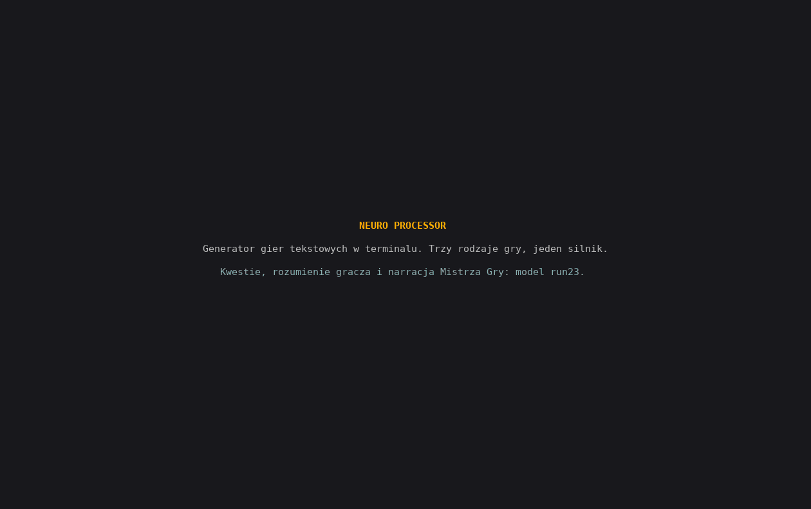
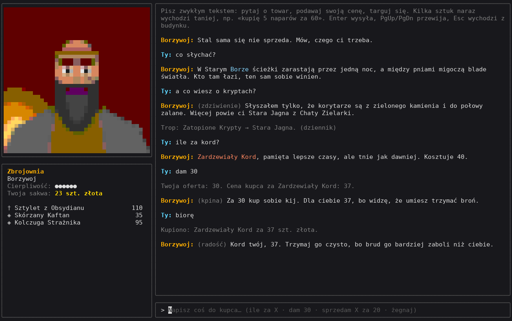
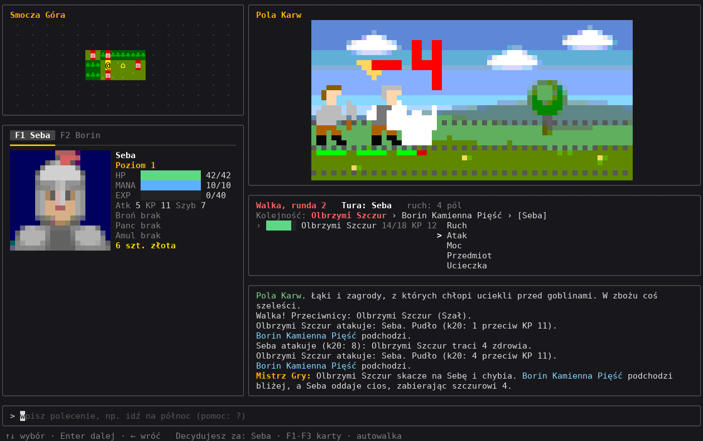
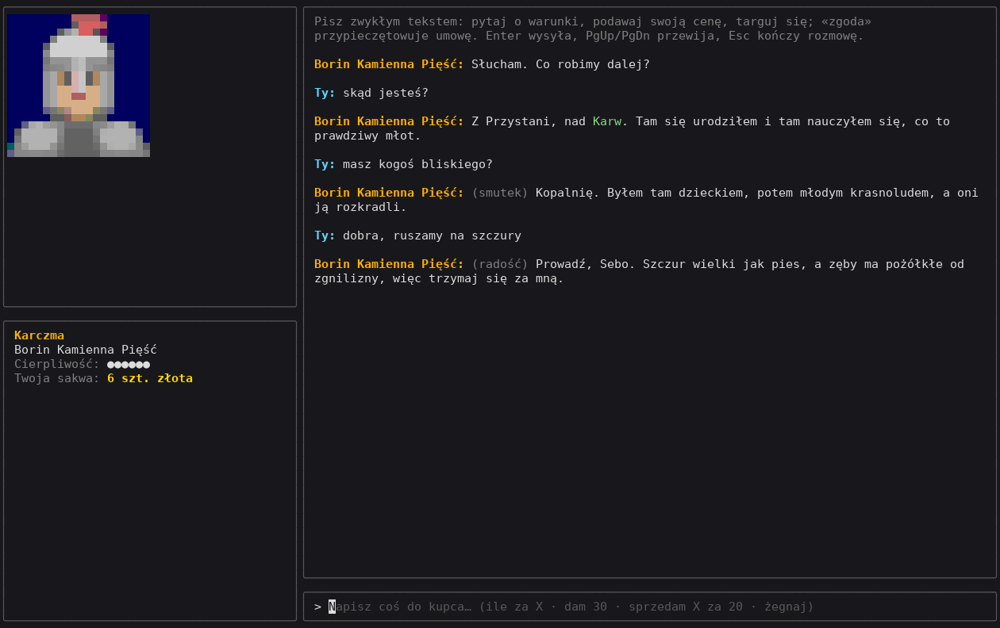
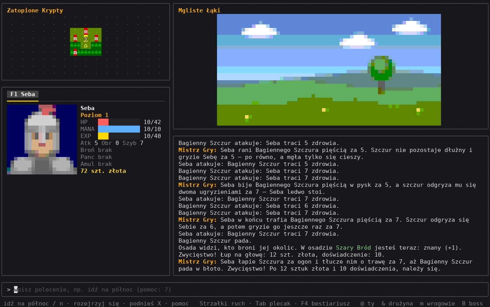
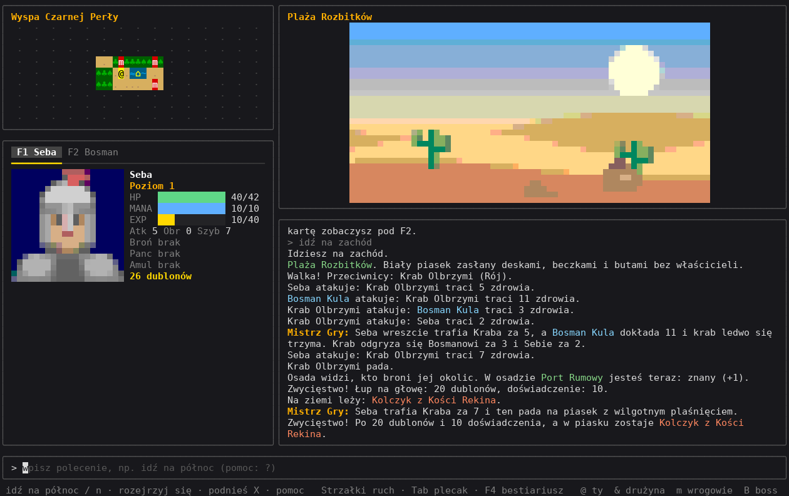
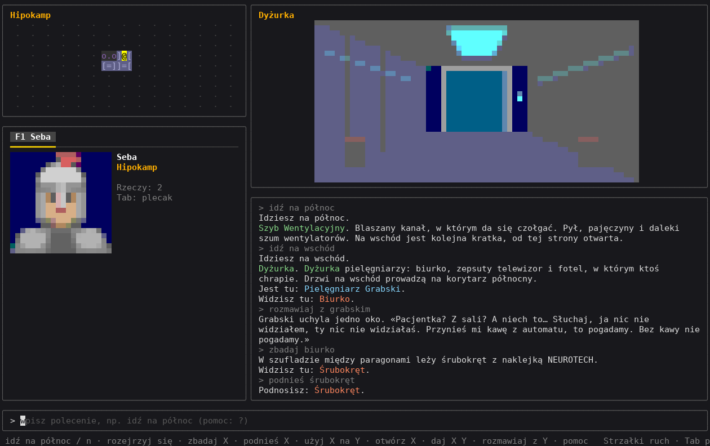
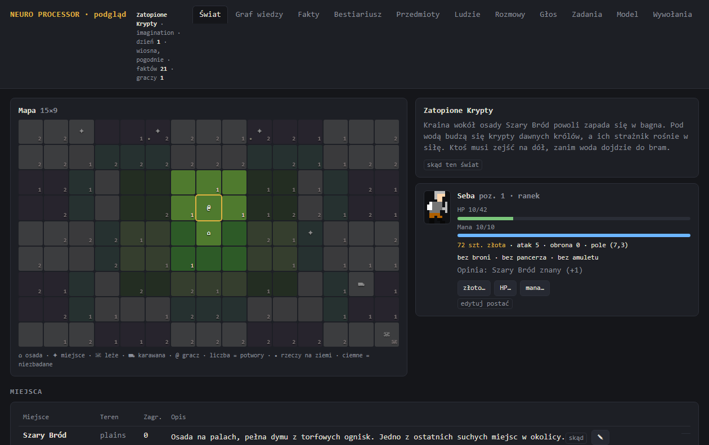

Neuro Processor
===============

*[English](README.md)* · **Polski**

[](https://github.com/sebastianrozmus/neuro-processor/actions/workflows/go.yml)
[](LICENSE)



Tekstowa gra RPG w terminalu, która sama wymyśla światy. Opisujesz w paru słowach, o czym ma być gra, a model językowy wymyśla miejsca, potwory, przedmioty i ludzi. Mapę, statystyki, ceny i zasady wylicza kod, więc każdy świat od razu da się grać. Inspiracją był *Mózgoprocesor*: rysunek miejsca na ekranie, polecenia wpisywane tekstem.

Najważniejsza zasada: **o wyniku decydują reguły, model tylko opowiada.** Z kupcem targujesz się zwykłym tekstem, z najemnikiem o żołd, Mistrz Gry opisuje walkę, a plotki krążą między osadami. Cenę, trafienie i to, kto co wie, zawsze liczy gra, a każdą kwestię modelu sprawdza (kwoty, imiona, fakty), zanim zobaczysz ją na ekranie.

Wszystko działa lokalnie przez [Ollamę](https://ollama.com). Za postaci mówi Bielik 11B douczony specjalnie pod tę grę.

Co tu jest
----------

- **Generator światów** z jednego zdania, w czterech rodzajach gry. Kod sprawdza i naprawia projekt modelu, a gotowy świat zapisuje.
- **Rozmowy zwykłym tekstem**: targ, sprzedaż, pytania o świat. Każda kwestia ma nastrój (`[kpina] Tyle za rurę?`), który słychać w głosie.
- **Żywy świat**: graf wiedzy (kto co wie), plotki, tropy, wydarzenia, pogoda i pory roku, karawana, sława w osadach, zlecenia z plotek.
- **Postaci z pamięcią**: towarzysz, który raz powiedział, że ma brata, pamięta to w następnej rozmowie.
- **Podgląd w przeglądarce** (`NEURO_DEBUG=on`): mapa, graf wiedzy, bestiariusz, edycja na żywo i historia każdego wpisu.
- **Gra w kilka osób przez SSH**: znajomi dołączają zwykłym `ssh`.
- **Głos i mikrofon** (opcjonalnie): Piper, Chatterbox z klonowanym głosem albo głos systemowy; mówisz do gry przez Whisper.
- **Pixel art w terminalu**: sceny, potwory i portrety ze znaków blokowych, a światy i awatary maluje lokalnie SD-Turbo.

| | |
|---|---|
| <br>Targ w zbrojowni (model run23) | <br>Walka D&D z komentarzem Mistrza Gry (run23) |
| <br>Rozmowa z Borinem (run25, kandydat nieprzyjęty) | <br>Mistrz Gry opisuje walkę (run25, kandydat nieprzyjęty) |
| <br>Wygenerowany świat (run21) | <br>Tryb przygodowy (teksty z pliku świata) |
| <br>Podgląd w przeglądarce | |

Animacja na górze i zrzuty pochodzą z prawdziwych modeli (`go run ./tools/demo -live`). Pod każdym obrazkiem podano run, który wygenerował tekst.

Rodzaje gry
-----------

| Rodzaj | Na czym polega | Wbudowane światy |
|---|---|---|
| **Gra wyobraźni** | mapa, osady, kupcy, drużyna, prosta walka, narrator | Zatopione Krypty, Popiół i Rdza, Stacja Erebus |
| **D&D** | to samo z zasadami stołowymi: k20, KP, kości broni, walka na siatce | Smocza Góra |
| **Przygodowa** | pokoje, przedmioty, zagadki, bez walki; z terminem robi się z niej escape room | Hipokamp, Pracownia Zegarmistrza |
| **Śledztwo** | miasteczko z ukrytą prawdą, ludzie z planem dnia, oskarżenie poparte dowodami | Jeziorna, Kanał 7 |

Jak zacząć
----------

**1. Gra.** Pobierz paczkę z [Releases](https://github.com/sebastianrozmus/neuro-processor/releases) i uruchom `neuro` albo zbuduj ze źródeł (Go 1.22+):

```sh
go run ./cmd/neuro
```

Potrzebny jest terminal co najmniej 118×36 z 256 kolorami. Na macOS plik pobrany przeglądarką odblokowuje `xattr -d com.apple.quarantine neuro`. Bez modelu gra też działa: wbudowane światy, walka, zapis i gra w kilka osób, tylko kupcy mówią gotowymi kwestiami.

**2. Model (zalecany).** Zainstaluj Ollamę i pobierz:

```sh
ollama pull hf.co/rozmus/neuro-npc-bielik-11b-v3-GGUF:Q5_K_M
```

Potem utwórz `.env.local` w katalogu, z którego uruchamiasz grę, albo w katalogu danych gry. Jeden model robi wszystko:

```
NEURO_LLM_BASE_URL=http://localhost:11434/v1
NEURO_LLM_MODEL=hf.co/rozmus/neuro-npc-bielik-11b-v3-GGUF:Q5_K_M
NEURO_TALK_BASE_URL=http://localhost:11434/v1
NEURO_TALK_MODEL=hf.co/rozmus/neuro-npc-bielik-11b-v3-GGUF:Q5_K_M
NEURO_WORLD_MODEL=hf.co/rozmus/neuro-npc-bielik-11b-v3-GGUF:Q5_K_M
```

Potrzebuje ok. 8,7 GB pamięci karty (kontekst 8192); na RTX 4060 Ti kwestia zajmuje ok. 2 s. Przy mniejszej pamięci wpisz w `NEURO_LLM_MODEL` mały model ogólny, np. `gemma3:4b`, i usuń linie `NEURO_TALK_`.

Model to Bielik 11B v3.0 douczony pod tę grę (SFT + DPO): mówi za postaci, opisuje walki jako Mistrz Gry i wykonuje zadania „umysłu” (rozumienie gracza, notowanie faktów, pamięć postaci). Każdą wersję oceniają ślepo sędziowie na zestawach, których model nie widział. Opis i wyniki: [Hugging Face](https://huggingface.co/rozmus/neuro-npc-bielik-11b-v3-GGUF), pełna historia: [tools/model/MODELE.md](tools/model/MODELE.md) i [tools/model/HISTORIA.md](tools/model/HISTORIA.md).

**3. Graj.** Polecenia piszesz po polsku, wielkość liter i ogonki nie mają znaczenia: `idź na północ` (albo `n`), `rozejrzyj się`, `podnieś miecz`, `idź do zbrojowni`, `atakuj`, `najmij Bognę`, `dziennik`, `pomoc`. W sklepie po prostu rozmawiasz: `ile za kord?`, `dam 30`, `sprzedam kord za 40`.

Dokumentacja
------------

- [Jak grać](docs/GRA.md): polecenia, walka, drużyna, żywy świat, tryby D&D, przygody i śledztwa, gra w kilka osób.
- [Ustawienia](docs/USTAWIENIA.md): modele, zmienne `NEURO_*`, głos i mikrofon, obrazki, podgląd w przeglądarce.
- [Jak to działa](docs/SILNIK.md): silnik, kontrole kwestii, model `neuro-npc` i jak go douczyć.
- [Wydania](docs/WYDANIA.md): jak powstaje nowa wersja.

Rozwój
------

```sh
go test ./...
go vet ./...
```

Pierwsza wersja projektu, w PHP i Symfony, leży na gałęzi `php-legacy`. To hobbystyczny eksperyment i zabawa, nie projekt komercyjny.

Licencja
--------

MIT, zob. [LICENSE](LICENSE). Zbudowane na [Bubble Tea](https://github.com/charmbracelet/bubbletea), [Lip Gloss](https://github.com/charmbracelet/lipgloss) i [Wish](https://github.com/charmbracelet/wish). Modele pobiera się osobno, każdy na własnej licencji: [Bielik](https://huggingface.co/speakleash), [Gemma 3](https://ai.google.dev/gemma), [SD-Turbo](https://huggingface.co/stabilityai/sd-turbo), [Whisper](https://huggingface.co/mlx-community/whisper-large-v3-turbo), [Chatterbox](https://github.com/resemble-ai/chatterbox), [Piper](https://github.com/rhasspy/piper) z polskimi głosami z [piper-voices](https://huggingface.co/rhasspy/piper-voices) (CC0). `tools/data` przerabia zbiór [FIREBALL](https://huggingface.co/datasets/lara-martin/FIREBALL) (CC-BY-4.0).
